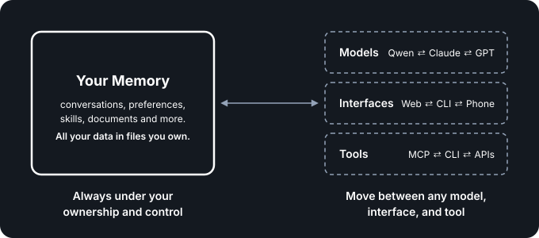
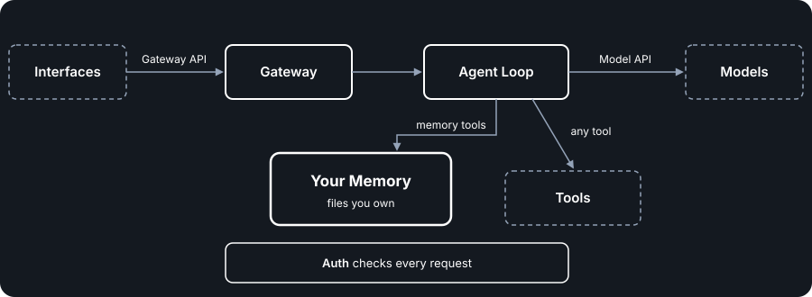

# Personal AI Architecture

**Own your AI.** An open blueprint for building personal AI systems. Keep your memory, swap everything else.

  

  <a href="https://personalaiarchitecture.org">Website</a> · <a href="https://github.com/Personal-AI-Architecture/ts-architecture-template">TypeScript template</a> · <a href="https://community.braindrive.ai/c/personal-ai-architecture/39">Forum</a>

## What this is

Not an app, and not a framework you install. A blueprint, plus a starter kit to build from.

- **The specs** (this repo, [`docs/`](docs/)): the principles, component specs and rules that keep every part swappable.
- **Contracts and tests** (this repo, [`specs/`](specs/)): OpenAPI and JSON Schema contracts for every boundary, plus conformance guidance to check your system really can swap its parts.
- **The starter kit** ([ts-architecture-template](https://github.com/Personal-AI-Architecture/ts-architecture-template)): a working TypeScript starting point with all four components built in.

## How it works

  

Four components and two APIs:

| Part | What it does |
|------|--------------|
| [Your Memory](docs/in-depth-overview/memory-spec.md) | All your data, in files you own. Everything else depends on it; it depends on nothing. |
| [Agent Loop](docs/in-depth-overview/engine-spec.md) | Calls the model, runs the tools it asks for, and repeats until the job is done. |
| [Gateway](docs/in-depth-overview/gateway-spec.md) | One front door for every interface. Start on the web, pick up on your phone. |
| [Auth](docs/in-depth-overview/auth-spec.md) | Controls who and what gets in. Swapping other parts never changes it. |
| [Gateway API](specs/openapi/gateway-api.yaml) | How interfaces connect. Anything that speaks it plugs in. |
| [Model API](specs/openapi/model-api.yaml) | How models connect. Switch providers with a config change. |

## Start here

| I want to... | Start here |
|--------------|------------|
| Understand the architecture | [Architecture overview](docs/in-depth-overview/foundation-spec.md) |
| Build a system | [TypeScript template](https://github.com/Personal-AI-Architecture/ts-architecture-template) |
| Build with an AI coding agent | [AGENT.md](AGENT.md) and the [architecture primer](docs/ai-agent-docs/) |
| Build one component | [Blueprints](docs/blueprints/) |
| Check my system conforms | [Conformance guide](docs/in-depth-overview/conformance/) |
| Check for lock-in | [Lock-in gate](docs/in-depth-overview/lockin-gate.md) |

## Built on PAA

[BrainDrive](https://braindrive.ai) is a personal AI assistant you own and control, built on all four PAA components by the team that wrote this architecture. Built something on PAA? [Share it on the forum](https://community.braindrive.ai/c/personal-ai-architecture/39).

## Contributing

We welcome pull requests for documentation, contracts and specification improvements. See [CONTRIBUTING.md](CONTRIBUTING.md).

## License

MIT. See [LICENSE](LICENSE).
