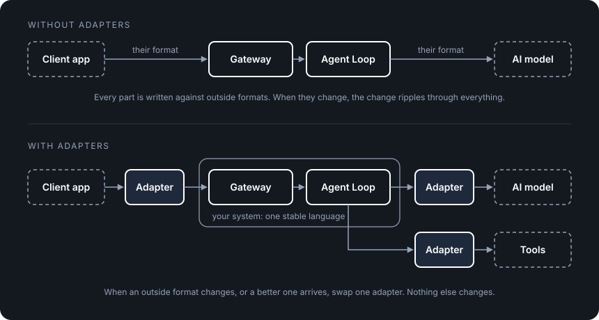

# Adapters

**Serves stories:** US-5, US-7 in the [PAA spec](../spec/personal-ai-architecture-spec.md).

## What adapters are

An adapter is a small translator between your AI system and the outside world. The parts of your system speak one stable language that you control. The adapter translates it into whatever language a client app or a model provider speaks.

Most AI software is written directly against the formats it uses: a company's API, like OpenAI's or Anthropic's, but also open protocols and open-source projects. Closed or open, those formats keep changing, and better ones keep arriving. When they change, the change ripples through the whole system.

We think that's a quiet kind of lock-in, and open source doesn't solve it. A system built around an open protocol is tied to it just as surely as one built around a closed API. In AI, the best standard today may not be the best one next year, and you want to be able to use the latest and greatest as it arrives. Inventing your own format doesn't help either. You'd have to maintain it forever, without the tools and community everyone else's has.

So PAA puts an adapter at each place your system meets an outside format: between client apps and the Gateway, between the Agent Loop and the models, and between the Agent Loop and each kind of tool. The parts of your system never see an outside format. The adapter does the translating, and nothing else.

That means you can use the best standard available without being tied to it. When a provider changes its format, or a better standard comes along, you swap one small adapter. Nothing else in your system changes. The cost of adopting anything new is one swap, not a rebuild.

<p align="center">
  
</p>

## How it works

This works because translating is a small, well-defined job. Every model provider does the same thing, taking a request and sending back a reply, just in slightly different formats. Every client app does the same thing, sending a message and getting a reply. The differences are only in format, so a small translator can absorb them.

- **Between the Agent Loop and models:** the adapter turns the Agent Loop's request into the provider's format and turns the provider's reply back. The provider's quirks stay inside the adapter, such as how it takes API keys, how it streams and how it writes tool requests. Changing provider means using a different adapter, and the Agent Loop never knows.
- **Between client apps and the Gateway:** PAA's Gateway API is a plain web API. If client apps expect a different format, such as the one many chat apps already speak, an adapter can translate it, and the Gateway never knows. This swap is rare.
- **Between the Agent Loop and tools:** each kind of tool source, such as MCP, has its own adapter, so a new tool protocol is one more adapter, not a change to the Agent Loop.
- **One job only:** an adapter only translates. If describing what it does needs an "and," it's doing too much, and that extra logic belongs in one of the system's parts.
- **Your choice, not a rule:** nothing forces you to use adapters. You can hard-code a provider and the system still works, but each shortcut is lock-in you've chosen. PAA makes the swappable path the easiest one, not the only one.

Adapters don't add parts to the system. They sit at its edges, and the system still has four components and two APIs.

The rest of this doc is the specification: what any implementation of adapters must do.

---

## What counts as an adapter

An adapter is a stateless translation layer between a part of the system and an outside format. On one side is an internal interface that the system defines and controls; on the other is whatever external standard is current. The adapter translates between them and does nothing else (D139).

Adapters are an implementation pattern at the system's edges. They add no components, APIs or architecture contracts: the architecture remains four components, two APIs and three external dependencies. The Gateway API is still the Gateway API and the Model API is still the Model API; an adapter is how each one can point at different external standards over time.

**The discipline:** you can describe what an adapter does in one sentence, such as "translates one provider's chat format to the internal message interface". If the sentence needs an "and", the adapter is doing too much, and that logic belongs in a component.

## The three adapters

### Gateway API adapter: between clients and the Gateway

**External interface (today):** The Gateway API defined in `contracts/openapi/gateway-api.yaml`: a plain REST and Server-Sent Events API for sending messages and managing conversations (for example `POST /conversations/messages`). It is not OpenAI Chat Completions. A Gateway API adapter can add another external format, such as Chat Completions, for clients that already speak it.

**Internal interface:** Message in, response out. The Gateway receives a normalized request (messages, conversation ID, metadata) and returns a normalized response stream. It doesn't know or care what protocol the client spoke.

**What the adapter does:**
- Translates inbound client requests from the external standard into the internal interface
- Translates outbound Gateway responses from the internal interface into the external standard
- This is the only place the external protocol lives

**Swap scenario:** Clients start expecting a different standard. Write a new adapter that translates the new format to/from the same internal interface. Gateway doesn't change. Auth doesn't change. Agent Loop doesn't change. Clients adopt the new standard at their own pace (or you run both adapters during transition).

### Model API adapter: between the Agent Loop and models

**External standard (today):** Provider-specific formats (OpenAI, Anthropic, OpenRouter — all variations on prompt + tool definitions in, completion + tool calls out).

**Internal interface:** Prompt in, completion out. The Agent Loop sends a normalized request (system instructions, messages, tool definitions, context) and receives a normalized response stream (text, tool calls, done). It doesn't know what model or provider is behind the adapter.

**What the adapter does:**
- Translates outbound Agent Loop requests from the internal interface into the provider's format
- Translates inbound model responses from the provider's format into the internal interface
- Handles provider-specific details (auth headers, streaming formats, tool call schemas)
- Reports provider failures to the Agent Loop; it does not silently switch to another provider

**Swap scenario:** Switch from OpenRouter to a direct Anthropic integration, or to a local Ollama instance. Write (or select) an adapter for the new provider. Agent Loop doesn't change. Gateway doesn't change. Your Memory doesn't change.

Provider errors are translated too, into the error categories of the Model API and Agent Loop contracts. Which codes those include for missing models and abilities is open (GAP-PAA-27).

### Tool-source adapter: between the Agent Loop and tools

**External standard (today):** each kind of tool source has its own: MCP servers, command-line tools, native functions, manifests.

**Internal interface:** the canonical tool definition (`contracts/schemas/tool-definition.json`) and the tool call and tool result shapes of the shared message contract. The Agent Loop sees only these. It doesn't know which protocol a tool speaks.

**What the adapter does:**
- Turns a tool source's self-descriptions into canonical tool definitions, recording the source in `source.id` and `source.kind`
- Runs a tool call through the source's own protocol and returns a canonical tool result
- Keeps the source's endpoints, credentials and protocol settings in runtime configuration, never in tool definitions

**Swap scenario:** a new tool protocol arrives. Write (or select) a tool-source adapter for it. The Agent Loop doesn't change, the model sees the same kind of tool definitions, and Auth governs the new tools the same way. This adapter is internal: it does not make tools an API (D53). (GAP-PAA-30: `source.kind` is a fixed list, so a new protocol currently needs a contract change to be labelled.)

**Which swap is common:** provider adapters change whenever the owner changes model provider. Tool-source adapters change when a new tool protocol is adopted. The Gateway API adapter changes only if the standard clients expect shifts.

## How Model Configuration Works in Practice

The architecture works with any model out of the box — cloud, local, future. You set which model to use in configuration. The system uses that model for everything. When you want a different model, you change the configuration. That's it.

Three pieces of config control this:

**1. Runtime config** tells the system which adapter to use:
```json
{ "provider_adapter": "openrouter" }
```

**2. Adapter config** tells the adapter how to reach the provider:
```json
// adapters/openrouter.json
{
  "base_url": "https://openrouter.ai/api/v1",
  "api_key_env": "OPENROUTER_API_KEY"
}
```

**3. Your preference** (in Your Memory) tells the system which model you want:
```
"I prefer anthropic/claude-sonnet-4-6 via OpenRouter"
```

At boot, the system loads the adapter. On every message, the Gateway reads your current model preference and passes it to the Agent Loop with the request, and every request flows through the same path: Agent Loop → Model API Adapter → model. Your client doesn't need to know which model is behind the system — it sends messages to the Gateway API and gets responses back.

### Two kinds of change

**Same provider, different model** — change your model preference in Your Memory. One change: the next message uses the new model, with no restart. This holds for models the loaded adapter supports; a model it can't reach is reported, never silently replaced (see [models-spec.md](./models-spec.md) §Errors).

| Before | After | What changed |
|--------|-------|-------------|
| Preference: `claude-sonnet-4-6` | Preference: `claude-opus-4-6` | One preference in Your Memory |

**Different provider, same format** — if the adapter config lists the provider as a profile, change your active provider preference in Your Memory. Like a model change, the next message uses it, with no restart (D193).

**Different provider, new format** — change `provider_adapter` in runtime config and provide the new adapter config. Two changes, still config-only, zero code. A restart is allowed.

| Before | After | What changed |
|--------|-------|-------------|
| `provider_adapter: "openrouter"` | `provider_adapter: "ollama"` | Runtime config (1 field) |
| `adapters/openrouter.json` | `adapters/ollama.json` | Adapter config (1 file) |
| `$OPENROUTER_API_KEY` | *(not needed — Ollama is local)* | Environment variable |

In both cases: Agent Loop doesn't change. Gateway doesn't change. Auth doesn't change. Your Memory doesn't change (except the preference). Your client doesn't change. This is the D147 anti-lock-in test — if any swap requires code changes, lock-in has been introduced.

See [configuration-spec.md](./configuration-spec.md) for runtime config details, boot sequence, and the full anti-lock-in test.

---

## What adapters complete

Without adapters, a contract binds to whichever standard it was written against, so changing the standard means changing both sides. With adapters, every layer has an intermediary:

| Thing | Swappable via | Swap cost |
|-------|--------------|-----------|
| Your Memory storage | Tools | Zero: tools absorb it |
| Components | Contracts | One component swap |
| Contracts and outside standards | Adapters | One adapter swap |

Auth stays swappable through its independence from the other parts.

## Using adapters is a choice

Nothing stops an implementation from bypassing adapters, hard-coding a provider or coupling components directly. The system still works, but each shortcut is lock-in the owner has chosen to accept. The architecture makes the swappable path the easiest path, not the only one, because enforcing it would mean the platform deciding what the owner may do with their own system.

## Checking an implementation

- [ ] Provider-specific request formatting, streaming and error details live in the Model API adapter, not the Agent Loop or Gateway
- [ ] Client protocol details live in the Gateway API adapter, not the Gateway
- [ ] The Agent Loop works only with canonical tool definitions, calls and results; tool-protocol details live in tool-source adapters
- [ ] Each adapter is stateless and does one job: translate
- [ ] Swapping a model provider changes only the adapter, its config, the startup config and the API key secret
- [ ] Adding a tool protocol means adding a tool-source adapter, with no change to the Agent Loop, Gateway, Auth or Your Memory
- [ ] Runtime config, adapter config and owner preferences stay distinct
- [ ] *(security)* Adapter config holds references to secrets, never the secrets themselves

---

## Decisions

| # | Decision | Rationale |
|---|----------|-----------|
| D139 | Contracts are swappable via adapters — completing the zero-lock-in architecture | Components are swappable through contracts, but contracts bind to a specific standard. Adapters absorb the standard: components speak an internal interface, adapters translate to/from the external standard. Swap the standard → swap the adapter → nothing else changes. Completes the chain: Your Memory via tools, Components via contracts, Contracts via adapters. |

---

## Contract alignment

The canonical Model API contract is streaming-only at the boundary, with normalized
completion events identified by `_event_type`; provider-specific streaming or
non-streaming transport remains an adapter implementation detail. Tool definitions
retain canonical source identity and visibility semantics while adapters provide only
provider-specific translation and runtime configuration.
