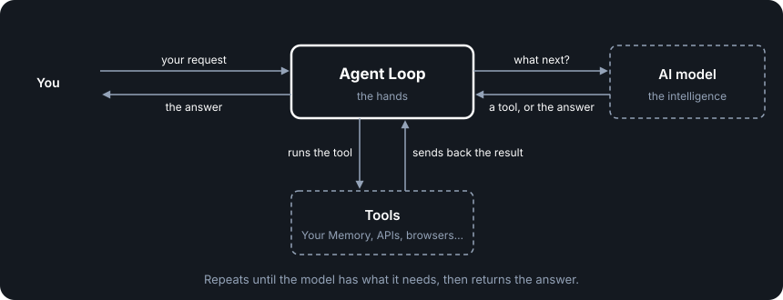

# Agent Loop

## What the Agent Loop is

The Agent Loop connects the AI model to your tools. It takes your request, sends it to the AI model, runs the tools the model asks for, and repeats until the job is done.

Every AI system has an agent loop, but in most of them the loop is where the product lives: its personality, its instructions, how it handles memory and context, which tools it uses. That bundle is often called the harness.

We think that's the wrong approach, for two reasons.

First, harnesses were built for a time when models needed a lot of help. They couldn't plan well, choose the right tools or keep track of context, so products built that logic into the loop. Models now do most of this themselves, and whatever they can't do yet, they likely will soon. Logic built into the loop to make up for the model becomes something you'll have to rip out, or it gets in the model's way.

Second, whatever is built into the loop is tied to that product's code. You can't take it with you, and you can't switch to a better loop without starting over.

So PAA takes all of that out. The Agent Loop is deliberately generic: no product-specific logic, no personality of its own, and no built-in knowledge of what it's working on.

Think of it as a hand. A hand can hold any tool: a hammer, a pen, a scalpel. A skilled surgeon and an untrained person have the same hands; the difference is the brain directing them. In PAA, the brain is the model plus Your Memory, where your skills, instructions and way of working live. The Agent Loop just does what the model tells it to. As the model gets smarter, the hand doesn't need to change.

Because nothing that makes your AI yours lives in the Agent Loop, you can replace it with a better one at any time, and Your Memory and every other part of the system stay exactly as they are.

  

## How it works

Because the model does the deciding, the loop's job is simple. It has four steps:

1. Accept a message from the Gateway.
2. Send it to the model through the Model API, along with the conversation so far and the tools available.
3. Run the tools the model asks for, after checking with Auth that each one is allowed. If Auth says no, the tool isn't run and the model is told.
4. Send the results back to the model, and repeat until the model says it's done.

Throughout, it streams what's happening (the model's text, the tools it calls and their results) back to the Gateway as it happens.

Just as important is what it doesn't do. It doesn't decide what to read or which tools to use; the model does. It doesn't store conversations; the Gateway does, in Your Memory. It doesn't decide who's allowed to do what; Auth does. Every time a job like that creeps into the loop, the loop becomes tied to one product, and that's how lock-in starts.

---

The rest of this doc is the specification: what any implementation of the Agent Loop must do.

**Serves stories:** US-5, US-7, US-8 in the [PAA spec](../spec/personal-ai-architecture-spec.md).

## What the Agent Loop does and doesn't do

### The loop

The Agent Loop runs a loop:

1. **Accept a message** — from the Gateway (which routes requests from clients, API calls, scheduled triggers, or other agents)
2. **Send it to a model** — the model named in the request, along with a system prompt, tool definitions, and conversation history, through the Model API
3. **Execute tool calls** — whatever the model decides to do, through the tool protocol. Before each call, the Agent Loop asks Auth whether this actor may make it; a call Auth refuses is not run, and the model is told it was not permitted
4. **Repeat** — send the tool results back to the model, until the model signals it's done

Throughout the loop, the Agent Loop streams the model's text, tool calls, tool results and the completion signal back to the Gateway as they happen.

That's the complete behavior. Four steps, streamed throughout.

### What the Agent Loop does not do

These are explicit boundaries. They exist to prevent product-specific logic from creeping into the Agent Loop over time.

| Responsibility | Where It Lives | NOT in the Agent Loop |
|---------------|---------------|-------------------|
| Prompt assembly | **The model** reads context files from Your Memory through tools | Agent Loop does not construct product-specific prompts |
| Skill execution | Your Memory (skill files read and followed by the model) | Agent Loop does not have a skill framework |
| Approval flow | Auth (the owner's rules) + tools + model instructions. Whether anything asks the owner first is the product's choice; the architecture default is that the owner can do everything | Where enabled, the Agent Loop emits the canonical pending request and terminal outcome events but does not own approval authority |
| Scope constraints | Tool configuration (which tools are available) + Auth (which tools this actor may call) | Agent Loop asks Auth before each tool call and honours the answer; it does not decide permissions itself |
| Context loading | Model reads files through tools based on its instructions | Agent Loop does not decide what context to load |
| Conversation persistence | The Gateway, which stores conversations in Your Memory through its conversation store tool (D152) | Agent Loop does not own conversation storage |
| Older conversation selection | Gateway prepares a model-sized working context from the saved conversation | Agent Loop does not cut or summarize history |
| Error recovery | Agent Loop reports provider failures; it may retry once on the owner's selected model and provider profile and records the retry; a product or caller may explicitly retry or change provider after a failed turn | Agent Loop never silently switches to another model or provider (D188) |
| Authentication | The Gateway calls Auth on every request before it reaches the Agent Loop | Agent Loop does not authenticate requests |
| Product personality | Memory files the model reads | Agent Loop has no personality; its bootstrap prompt only says where to look |

---

## What the Agent Loop guarantees

- Messages sent to the Agent Loop reach the model when the call fits; otherwise the loop reports `context_overflow` without silently changing them
- Permitted tool calls the model makes get executed
- Responses stream back to the caller
- The loop continues until the model signals completion. The Agent Loop MUST NOT impose a default iteration cap. Implementations MAY configure a safety bound as a deployment choice, but the Agent Loop itself never terminates the loop before the model signals done.
- When the model emits text and tool calls in the same turn, the Agent Loop preserves the text in the assistant message for the next loop iteration. Streamed text is never silently discarded on tool continuation.
- The model can dispatch multiple tool calls in parallel within a single loop — the Agent Loop executes independent calls concurrently, preserves stable call/result association, and keeps dependent calls ordered before returning all results
- Before each model call, including a continuation after live tool results, the Agent Loop checks the actual request against the selected model's known or verified conservative context limit. It includes its bootstrap prompt, tool definitions and response headroom. If the call cannot fit, it reports `context_overflow` without shortening the live result or silently dropping parts.
- It reads that limit from the selected provider profile and model (D193). If no safe limit exists, it reports `context_limit_unknown` and makes no model call.

---

## The Agent Loop contract

The Agent Loop sits in the middle of the foundation's flow: clients connect through the Gateway, the Gateway routes to the Agent Loop, the Agent Loop calls models through the Model API and executes tools from the environment. Your Memory is the platform — the Agent Loop reads and writes to it through tools. The Gateway ↔ Agent Loop interface is defined in [gateway-agent-loop-contract.md](../architecture/gateway-agent-loop-contract.md) (D137). The Agent Loop receives a messages array (selected conversation history + unchanged current message), the model and provider to use for this request, and metadata via `POST /agent-loop/chat`, then returns an SSE stream of events (text-delta, tool-call, tool-result, optional approval-request/approval-result, done, error). The Agent Loop adds its own bootstrap prompt from its configuration. Messages use one shape across all three contracts: tool calls and tool results are ordinary parts of messages, so they travel in conversation history like everything else. The Gateway calls Auth on every request before anything reaches the Agent Loop, and the Agent Loop asks Auth before each tool call.
The internal request also carries the canonical transport-neutral `auth_context`; it contains the authenticated actor and trace timestamps, never credentials or permissions. The receiving transport adapter verifies it before the Agent Loop uses the actor for per-tool Auth checks.

### Per-Request Input (via Gateway)

| Field | Description | Required |
|-------|-------------|----------|
| Message | The actor's message (or a system trigger) | Yes |
| Conversation history | Prior messages in this conversation, including the tool calls and tool results they contain | No (first message has none) |
| Model | The model to use for this request. The Gateway reads the owner's current model choice on every message and passes it here, so a changed choice applies to the next message with no restart | Yes |
| Provider | The owner's active provider profile. Read and passed with the model on every message (D193); the Agent Loop uses it and never substitutes another | Yes |
| Auth context | The canonical `auth_context`: the authenticated actor, an authentication ID, timestamps and the correlation ID; never credentials or permissions. The Agent Loop uses the actor for each tool check and never modifies it | Yes |
| Correlation ID | Request trace ID generated by the Gateway (`metadata.correlation_id`); flows through to tools and logs | Yes |
| Trigger | What started the request: `message`, `webhook` or `schedule` | No (default: `message`) |

The full field list, including optional metadata, is in [gateway-agent-loop-contract.md](./gateway-agent-loop-contract.md).

### Boot-Time Configuration

| Field | Description | Source |
|-------|-------------|--------|
| Bootstrap prompt | Minimal startup instructions for the model (e.g., "Read AGENT.md for your instructions"). The model constructs its working context by reading Memory through tools. | Agent Loop configuration (D50) |
| Tool sources | Where to find installed tools. The Agent Loop asks configured sources for self-descriptions; separate and remote tools can be re-discovered without restarting it (see [tools-spec.md](./tools-spec.md)) | Runtime config `tool_sources` (D143, D196) |
| Always-send set | Which tool definitions go to the model on every call; every other tool is loaded on demand through the discovery tool | The owner's preference, in Your Memory |
| Provider configuration | Which provider adapter, its provider profiles, and a secret reference for each | Runtime config + adapter. The model and the active provider profile are not boot-time configuration: they arrive with each request (D193) |

The bootstrap prompt solves a chicken-and-egg problem. Prompt assembly lives in Your Memory (skills, context, personality and instructions are all files), but the model needs instructions before it can read Your Memory. The bootstrap is the BIOS: tiny, generic, just enough to tell the model where to look. Everything else the model discovers by following that instruction. The specific bootstrap content is an implementation choice.

See [configuration-spec.md](./configuration-spec.md) for the full boot sequence (D143).

### Output

| Field | Description |
|-------|-------------|
| Streamed response | Text generated by the model, delivered as it's produced |
| Tool calls | Each tool call the model makes, before it runs |
| Tool call results | Results of any tools the model called during the loop, including calls Auth refused |
| Completion signal | Indication that the model is done |
| Error | An unrecoverable failure mid-stream, with a message safe to show the client |

### Error output

| Condition | Agent Loop behavior |
|-----------|----------------|
| Model unreachable | Report failure to caller |
| Selected model unavailable through the selected provider profile | Report `model_unavailable`; do not switch model or provider (D197) |
| Selected model lacks a requested ability | Report `capability_unsupported` with the missing `capability`; do not fake the result (D197) |
| Tool execution fails | Report failure to model (model decides next step) |
| Tool call not permitted by Auth | Report to the model that the call was not permitted (model decides next step) |
| Context too large for the model | Report `context_overflow` to the caller |
| Auth unavailable | Fail closed: a tool call that can't be checked is not run (see [auth-spec.md](./auth-spec.md) "Auth unavailable") |
| Provider timeout | Report failure to caller |
| Invalid input | Reject with error |

---

## Concurrency

The Agent Loop is one brain with two hands — one model that can dispatch multiple tool executions in parallel. Independent calls made in the same turn start together, so the model cannot pause one while another runs. The model avoids conflicts by not issuing conflicting calls in the same turn. If two writes to Your Memory do conflict, the Memory tools detect the conflict and report it back to the model; they never resolve it silently (see [memory-spec.md](./memory-spec.md) "Errors and concurrency").

This is the only concurrency the Agent Loop needs to handle: **parallel tool execution within a single loop.** The model calls several tools at once (for example, reading two files), the Agent Loop executes independent calls concurrently, keeps dependent calls ordered, results come back, and the model decides what's next.

**Multi-actor concurrency does not create shared Agent Loop state.** A collaborator or external agent may act through this system with a distinct authenticated actor and the permissions the owner grants. They use the same generic Agent Loop boundary, while separate systems may bring their own loops. Memory is inert — it does not care who is reading it. Auth gates every request and tool call, and Memory tools handle write conflicts. No actor receives permissions merely by sharing the owner's system.

| Scenario | What's happening | Agent Loop's role |
|----------|-----------------|---------------|
| Owner dispatches parallel tool calls | One model, multiple tool executions | Execute them concurrently, return results |
| Background task runs while owner chats | A separate trigger through the Gateway, its own loop, shared Memory via tools | Each runs in its own loop — Agent Loop is stateless between loops |
| Owner runs multiple conversations simultaneously | Separate requests, separate loops, shared Memory via tools | Each request gets its own loop — Agent Loop is stateless between loops |
| Collaborator accesses Memory simultaneously | A distinct authenticated actor uses this system or another system, with owner-granted permissions | Process the request under that actor's `auth_context`; Auth + tools handle access and write conflicts |
| External agent connects | A distinct authenticated actor connects through the Gateway, with owner-granted permissions | Process the request under that actor's `auth_context`; never substitute the owner identity |

---

## Checking an implementation

Items marked *(security)* are the per-component requirements from [security-spec.md](./security-spec.md), which owns the "why" (D131).

- [ ] Agent Loop accepts messages from any source through the Gateway and streams responses
- [ ] Agent Loop executes tool calls the model makes without knowing what the tools do
- [ ] Agent Loop works with any model through the Model API
- [ ] Agent Loop asks Auth before every tool call, runs only permitted calls, and tells the model when a call was not permitted
- [ ] Agent Loop runs no tool call it cannot check with Auth (fails closed)
- [ ] Agent Loop imposes no default iteration cap; the loop ends when the model signals done
- [ ] Text the model writes alongside tool calls is kept for the next iteration, never discarded
- [ ] Independent tool calls the model makes in one turn run at the same time, and all results return
- [ ] Agent Loop has zero product-specific code
- [ ] Agent Loop can be replaced with a different agent loop without changing any other component
- [ ] Swapping agent loops requires only changing the Agent Loop — Memory, Tools, Client, Auth, and Models are unaffected
- [ ] The Agent Loop must never store credentials, API keys, or tokens in its own state *(security)*
- [ ] The Agent Loop must not persist data between loops — each loop starts clean (the model reconstitutes from Memory) *(security)*
- [ ] Tool call results reach the model without modification or not at all, with `context_overflow` reported when the call cannot fit — the Agent Loop must not inject, filter, or alter tool results *(security)*
- [ ] Every model call is checked against the selected model's safe context limit, including continuation after tool results; overflow reports `context_overflow` without changing results
- [ ] The Agent Loop must report tool execution failures to the model, not silently retry or recover *(security)*
- [ ] The Agent Loop must enforce configured timeouts on tool calls — a slow or hung tool cannot block the loop indefinitely *(security)*
- [ ] When the Gateway sends cancellation for a revoked actor, the Agent Loop stops the active loop, cancels supported in-flight work, runs no further tool calls, and emits `auth_error`; the cancelled turn cannot be retried under the revoked context *(security)*

---

## Decisions

| # | Decision | Rationale |
|---|----------|-----------|
| D39 | The Agent Loop is a generic agent loop with no product-specific logic | Composability. A generic agent loop can pick up any tool the ecosystem produces. A domain-specific agent loop can only pick up domain-shaped things. Lock-in comes from tying what you do to how the agent loop works. |
| D40 | Prompt assembly and skill execution live in Your Memory, not the Agent Loop | The model reads skills and context through tools. Product behavior emerges from what's in the files, not from custom agent loop code. Same principle as D39 — don't tie intelligence to the loop. |
| D41 | The "harness" concept is replaced by Agent Loop + the other components working together | The harness was an abstraction for something that's actually just Your Memory + Agent Loop + Tools + Models. The agent isn't a component — it's what emerges when you connect the pieces. |
| D42 | Engine renamed from "Harness" — "Engine" reflects that it's a commodity component | Every engine does the same thing. What makes the car different is everything around it. The Engine is the boring, interchangeable part. |
| D50 | Bootstrap prompt is Agent Loop configuration — minimal seed that lets the model self-bootstrap from Your Memory | One line: "Read the entry point in the current folder." Everything else the model discovers from Your Memory by following that instruction. |
| D108 | Model API must remain an API, not a tool | The model decides what tools to call — you can't use a tool to call the thing that decides which tools to use. Circular dependency. The Model API is structurally different from tools. |
| D137 | Gateway ↔ Agent Loop is a plain HTTP API contract | `POST /agent-loop/chat` with messages array, model, provider and metadata. Agent Loop returns SSE stream. See [gateway-agent-loop-contract.md](./gateway-agent-loop-contract.md). |

---

## Contract alignment

The canonical `contracts/openapi/gateway-agent-loop.yaml` and shared message schema are
authoritative for the internal route, request fields, structured message parts, and
stream event shapes. The Model API handoff is streaming-only (`stream: true`), and
its events are discriminated by `_event_type`. This spec describes the ownership and
behavioral requirements behind those canonical definitions.

The canonical tool definition also carries source provenance and separate visibility
and authorization markers; tool calls retain source_id so same-named tools remain distinct.
