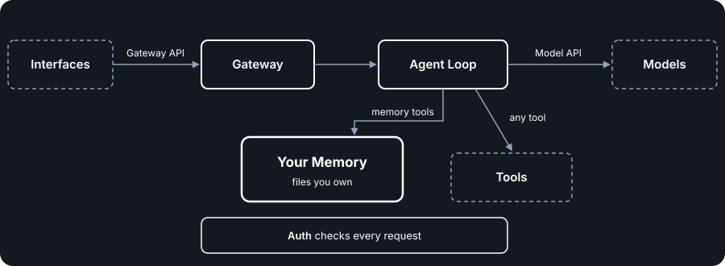

# Auth

## What Auth is

Auth decides who and what can act on your AI system, and what each of them is allowed to do. That covers you, the AI agents working for you, other people's AI systems you let in, and the services that act on your system.

In most AI products, access control is part of the app: a login screen and whatever rules the app decides to enforce. Some go further and leave it to the model, with instructions in the prompt about what it shouldn't do.

We think both are the wrong place for it. Rules that live in an app are lost when you leave the app. Rules that live in the model change whenever you change models, and a model can be talked out of them. Your security has to hold no matter which model, app or agent loop you're using.

So in PAA, Auth is its own component. You can do everything on your own system; everyone and everything else starts with no access until you grant it. Your rules belong to you and stay the same when you swap any other part of your system.

That means you can let an AI agent act on your behalf, or let another person's AI system reach what you choose to share, with exactly the access you choose, and change models or apps without losing your rules.

<p align="center">
  
</p>

## How it works

Because models can be swapped and can be tricked, Auth sits outside the model and is checked at two points:

1. **Every request.** When anything arrives at the Gateway, including just reading a conversation, the Gateway asks Auth who sent it and whether they may. If Auth says no, the request goes no further.
2. **Every tool call.** Before the Agent Loop runs a tool, it asks Auth whether this actor may use this tool here. If Auth says no, the tool doesn't run, and the model is told it isn't permitted.

The Gateway-to-Agent-Loop handoff carries Auth's actor context in the internal [`gateway-agent-loop.yaml`](../contracts/openapi/gateway-agent-loop.yaml) shape. The Agent Loop still asks Auth for each tool call; receiving a context is not an authorization decision for a tool.

The rules themselves are simple data: who, on what, doing what, allowed or denied. If no rule allows something, it's denied. You manage the rules the same way you manage everything else, by asking ("give my accountant’s AI read access to my finances"), and you can inspect and export all of them, along with a log of every action.

Just as important is what Auth doesn't do. It doesn't hold Your Memory or your conversations, route requests, run tools or decide what the AI should do. It answers one question, "who is acting, and may they?", and everything else asks it.

---

The rest of this doc is the specification: what any implementation of Auth must do.

**Serves stories:** US-3, US-7, US-10 in the [PAA spec](../spec/personal-ai-architecture-spec.md).

This is a **requirements and design spec**, not a technology choice. Any technology that meets the Auth contract is valid. Product choices such as the auth technology, MFA, login screens and how approvals look are implementation concerns (not published in this repository).

## Where Auth sits

Auth is a check that other components call through the Auth contract. It is called at two points:

1. **On every request, by the Gateway.** When a request arrives, the Gateway asks Auth who is making it and whether they may make it, before anything reaches the Agent Loop. This applies to every Gateway API request, including reading conversation history, not only to messages that reach the model. A request Auth rejects goes no further.
2. **Before each tool call, by the Agent Loop.** When the model asks to call a tool, the Agent Loop asks Auth whether this identity may use this tool on this resource. If Auth says no, the tool does not run, and the model is told the tool exists but is not permitted. That result is different from "this tool does not exist", so the model can tell the two apart.

```
Client → Gateway ──(who is this? may they?)──→ Auth
            │
            ▼ (only if allowed, with the identity attached)
        Agent Loop ──(may this identity use this tool here?)──→ Auth
            │
            ▼ (only if allowed)
          Tool
```

Auth stays independently swappable. The Gateway and the Agent Loop depend only on the Auth contract, not on any Auth implementation, and Auth knows nothing about the Gateway or the Agent Loop. Replace Auth and the Gateway doesn't change; replace the Gateway and Auth doesn't change.

**Permissions live only in Auth.** No other component, including Configuration, stores or decides permissions. Components ask Auth; they don't keep their own copy of the rules.

---

## Guiding principles

### The owner has full control

The owner can do everything on their own system. That is the default policy: on a new system, the owner is allowed every action, with no approval prompts required by the architecture. No product rule overrides the owner on their own hardware.

Everyone and everything else starts with nothing. A new identity has no permissions until the owner grants them. The system never grants itself or anyone else more access; the owner always drives expansion.

Whether to ask the owner before some actions (approval prompts), and which actions, is a product choice. Version history and restore in Your Memory are the safety net whatever the product chooses.

When a product enables approvals, Auth also owns the decision authority and lifecycle enforcement described in [security-spec.md](./security-spec.md#approval-lifecycle-when-a-product-enables-approvals): only an approval-authorized identity may resolve a pending request, and replaying a terminal decision is idempotent.

### Auth through conversation

The owner manages auth the same way they manage everything else: by asking. "Give my accountant’s AI read access to finances" should just work. Settings screens can exist as well. This means Auth is reachable through tools, so the agent can read and change permissions when the owner asks.

### Owner inspectability

The owner can inspect, change and export their complete auth state: identities, policies, configuration and audit log. No opaque databases. The auth data is theirs, like their memory.

### Each instance is its own authority

Each system is its own identity authority. There is no central auth server. Every instance can operate on its own, which is the basis for trust between instances later without a central authority.

### Open standards

Auth uses open standards wherever possible (OAuth 2.1, OpenID Connect, standard token formats), not proprietary protocols.

### Swappable implementation

The rest of the system depends on the Auth contract. The auth provider behind it is an implementation detail. Changing auth technology changes only the Auth component.

---

## What Auth does not do

| Responsibility | Where it lives | Not in Auth |
|---|---|---|
| Persist data | Your Memory (via tools) | Auth does not own memory storage |
| Decide what to do | Model (via Agent Loop) | Auth makes no content decisions |
| Route requests | Gateway | Auth does not route |
| Execute tools | Agent Loop | Auth does not execute |
| Manage conversations and record reply provenance | Gateway, which stores the model and provider with each saved assistant reply (D194) | Auth does not track conversations or choose models and providers |
| Define product behavior | Your Memory (instructions, skills) | Auth has no product logic |
| Keep secrets | Protected so only the owner can unlock them, including when they travel with Your Memory | Auth checks credentials without exposing them as ordinary Memory content to a model or tool |

Auth's job is one thing: **decide who is acting and whether they may**.

Tool availability is the owner's outbound data control. If the owner enables a tool that sends data outside the system, they have accepted that the model may send data to it. Finer outbound rules (such as "never send financial data to this tool") are implementation features.

---

## Identities

Every actor that uses the system has an identity. The identity model supports all actor types from the start, even if only the owner exists at first, so adding a new kind of actor is a data change, not a redesign.

### Identity types

| Type | Who it is |
|---|---|
| **Owner** | The person whose system this is. Full control. Exactly one per instance, and the only person who signs in. |
| **Interactive agent** | The AI agent acting for the owner in conversation, limited to the tools and memory it is given. |
| **Background agent** | A scheduled or autonomous task that runs with no person watching. It has its own identity so the owner can tell "the background task changed this" from "I changed this". |
| **External agent** | Another AI connecting from outside, acting for someone else or for the owner through an outside service. |
| **Service** | An integration, such as calendar sync or a webhook receiver, with scoped API access. |
| **Economic actor** | Something that can spend money. Needs spending limits and an audit trail. |
| **Another instance** | A whole other system connecting through open protocols. Trust is between instances; neither side needs an account on the other. |

Interactive and background agents run inside the deployment: code the owner deployed. External agents, services and economic actors are someone else's code asking for access. They must prove who they are, get explicitly scoped permissions, and can be cut off at any time.

New kinds of actor can be added. A new type gets no permissions until the owner grants them.

### Identity status

Each identity is in one of these states:

- **Active**: can sign in and act within its permissions.
- **Suspended**: cannot act. The owner can turn it back on.
- **Revoked**: permanently cut off. Revoking an identity stops anything it is doing.

Identities and permission rules move together with the owner's Memory. A supported grant becomes active only once the destination verifies the original identity and resource scope. An identity the owner adds later starts with no access until the owner grants it. Removing an identity removes its rules (see [Failure modes](#failure-modes)).

### Identity travels with the request

Once the Gateway has the identity from Auth, it passes the canonical `auth_context` to the Agent Loop with the request, and the Agent Loop uses that same actor identity for each tool check and for the audit log. In v1 the AI in a conversation acts under the owner's identity; distinct identities for AI agents acting for the owner are deferred to the agents step (D190). `auth_context` contains the authenticated actor, an authentication ID, timestamps, and correlation ID; it contains neither credentials nor permissions. The internal transport adapter verifies the component boundary and preserves the same context across HTTP, a message bus, or a direct function call. A missing, malformed, expired, or caller-supplied context is rejected.

---

## Permissions

### Policy model

A permission is a rule: **(identity, resource, action) → allow or deny**. Resources and actions are open-ended types, not fixed lists, so a new kind of permission is a new resource or action type, not a change to the model. Policies are data, not code: adding a permission is adding a rule.

If no rule allows an action, it is denied. The owner is the exception by default: the owner can do everything.

### Portable policy evaluation

Policy records use the matching rules in `contracts/schemas/policy.json` so an
exported policy has the same meaning across Auth implementations:

- `subject` matches an exact identity ID, `*` for every identity, or
  `type:<actor_type>` for every identity of that type. A missing or unknown identity
  reference is dormant and never grants access.
- `resource` matches exactly, `*`, or a trailing `/*` path prefix. A prefix matches
  the named path and its descendants; arbitrary mid-string wildcards are invalid.
- `action` matches exactly or `*`. Resource and action names remain extensible, but
  an implementation that does not understand a resource or action must preserve the
  rule, report it as unsupported, and deny rather than guess.
- All supplied `conditions` must be satisfied. The portable condition set is
  `time_window`, `max_per_day`, and `requires_approval`; unknown condition names make
  the rule unsupported and non-granting. `requires_approval` is decision metadata,
  not a predicate: a matching allow with it set requires the product's approval flow.
- If multiple applicable rules remain, any matching `deny` wins over every `allow`.
  If no deny matches but at least one allow matches, the action is allowed; otherwise
  it is denied. Rule order and provider-specific specificity scoring never change
  this result.

The `time_window` uses `HH:MM` wall-clock values and an explicit timezone when the
deployment default is not appropriate. `max_per_day` is counted by Auth for the
owner's calendar day. These semantics are part of the portable policy meaning, while
storage, indexing, and evaluation implementation remain product choices.

### What policies can cover

The model must cover these categories, and new ones can be added without redesign:

- **Memory access**: who can read, write and delete which parts of Your Memory: all of it, a folder, a single file, or read-only.
- **Tool access**: which tools each identity can use: all, read-only tools, a named set, or none.
- **System actions**: changing settings, managing permissions, or registering agents, services and other instances.
- **Delegation**: whether an identity can pass some of its own access on to others, never more than it has.
- **Limits**: how much, not just whether: AI usage budgets, spending caps per transaction, request rates, storage.
- **Approval**: which actions need someone's approval and who may give it. The architecture requires that an approval rule the owner sets is enforced; it does not require any approval by default.
- **External actions**: what an identity can do outside the system: read a calendar but not send email, buy within a limit, message approved contacts.
- **Administration**: who can change the rules themselves. By default only the owner.

---

## The Auth contract

The rest of the system never talks to an auth provider directly. It talks to the Auth contract, which is what makes the implementation swappable.

### Operations

| Operation | Input | Output | Called by |
|---|---|---|---|
| **Authenticate** | The request's credential (session, token or API key) | The identity: who, what type, what status | The Gateway, on every request |
| **Authorize** | Identity + resource + action | Allow or deny | The Gateway (for the request), the Agent Loop (before each tool call) |
| **Manage** | Identity + permission change | Success or failure | Auth tools, when the owner asks; any settings screen a product offers |

### Data format

The architecture, not the auth provider, owns the format of identity, policy and audit records. The provider stores data in this format. This allows:

- **Moving between providers** without losing identities or rules.
- **Export with memory**: identities, policies and the audit log come out in a known format.
- **Owner inspection**: the owner can see exactly what is in their auth state.

Identity records hold an ID, type, display name, creation time and status. Policy records hold the rules described in [Policy model](#policy-model).

### Audit log

Actions are recorded as the portable [audit record](../contracts/schemas/audit-record.json): who did what, when, to which resource, with what result, and under which correlation ID. This includes requests Auth denied, tool calls, cancellation/revocation events, and changes to identities and permissions. Audit logging is required from the start, including on a system with only the owner. Implementations may add non-sensitive detail, but must not put credentials, secrets, or raw private content in the record.

When the audit log cannot be written, alert the owner and record the outage when the log recovers. The implementation may stop or continue work during the outage. Report an action as audited only when its record was written. The audit log is the owner's data: protected like Your Memory, exportable and deletable by the owner.

### Auth tools

Auth is reachable through tools so the agent can read and change permissions in conversation. For example:

| Tool | What it does |
|---|---|
| `auth_whoami` | Returns the current identity and its permissions |
| `auth_check` | Checks whether an action on a resource is allowed |
| `auth_list_identities` / `auth_list_policies` | Lists identities or rules |
| `auth_create_identity` | Registers an agent, a service or another instance |
| `auth_grant` / `auth_revoke` | Grants or removes a permission, or revokes an identity |
| `auth_audit` | Queries the audit log |
| `auth_export` | Exports the complete auth state |

A conforming system needs at least `auth_whoami`, `auth_check` and `auth_export`. The others are added as more kinds of actor are supported.

---

## Failure modes

### Session expiry mid-conversation

**Scenario:** The owner's session expires in the middle of a conversation.

**Required behavior:** No work is lost. The session is renewed without interrupting the owner where possible. If it can't be renewed (for example, the credentials were revoked), the owner signs in again and the conversation is still there afterwards.

### Access revoked during an operation

**Scenario:** The owner revokes an external agent's access while it is mid-task.

**Required behavior:** Auth revocation causes the Gateway to send the active request's correlation ID to the Agent Loop's cancellation operation. The Agent Loop stops the loop cooperatively, cancels supported in-flight model/tool work, runs no further tool calls, and emits `auth_error`. Tool implementations must not commit writes after cancellation; writes already committed remain and are recorded. The agent cannot retry under the revoked context. The audit log records the revocation, cancellation request, and stopped operation.

### Owner locked out

**Scenario:** The owner has lost their local sign-in credentials.

**Required behavior:** The owner can reset local sign-in through the filesystem on their own hardware. The reset preserves the vault's existing access controls. An independently protected owner-controlled key, including a local key file, or an owner-configured recovery method can continue to unlock the vault. The login reset alone grants no access to protected secrets.

### Auth unavailable

**Scenario:** The auth provider crashes or can't be reached.

**Required behavior:** The system fails closed. Requests that can't be checked are refused, and tool calls that can't be checked don't run. No data is exposed. The owner sees a clear error.

### Audit log can't be written

**Scenario:** The audit log's storage is full or unavailable.

**Required behavior:** The owner is alerted; the outage is never hidden. Whether tool calls stop or continue is the implementation's choice, and nothing that ran is reported as audited. The failure itself is logged wherever logging is still possible. See [security-spec.md](security-spec.md#failure-modes).

### Permissions after export/import

**Scenario:** The owner imports identities and permission rules with their Memory.

**Required behavior:**

- Move identities and rules together. The import confirms activation for grants whose original identity and resource scope the destination can verify.
- Matching display names or IDs alone do not verify identity. Translated policies must cover the same resources and enforce the same conditions.
- Keep unsupported or unverified identities and rules as received, report them to the owner, and grant nothing. Once supported and verified, the original approval applies.
- Remove an identity's rules when the identity is removed. New identities and resources have access only where covered by a verified grant.

---

## Data portability

### What exports

| Data | Included | Format |
|---|---|---|
| Memory (files, content) | Exported by Your Memory, not Auth (see [memory-spec.md](./memory-spec.md) "Export") | As-is, open formats |
| Permission policies | Yes | The architecture's open format (JSON or YAML) |
| Identity records | Yes, details only | Names, types, creation dates, links to policies |
| Audit log | Yes | Queryable records of who did what |
| Auth configuration | Yes | The owner's auth settings, including any approval rules |
| Credentials | In the protected Memory export | Owner-unlockable with the original service, destination and purpose binding |

### What doesn't export

- The Auth-specific export omits credentials. They travel with Your Memory in protected form.
- Active sessions and tokens. They aren't valid on another instance.

Imported grants follow [Permissions after export/import](#permissions-after-exportimport).

---

## Evolution

Auth gains capability in phases. Each phase is additive; the contract doesn't change.

| Phase | What's added |
|---|---|
| **Owner only** | One owner with full access, API keys for programmatic access, audit log |
| **Internal agents** | Background agents with their own identities and scoped permissions |
| **External actors** | Outside agents and services, including other people's AI systems, with scoped credentials, delegation rules, per-resource access and usage limits |
| **Federation** | Trust between instances through open protocols, each instance its own authority |

The pattern: **add identity types and rules, don't change the contract.**

---

## Checking an implementation

Items marked *(security)* are the per-component requirements from [security-spec.md](./security-spec.md#per-component-requirements), which owns the "why".

- [ ] Every Gateway request is authenticated and authorized by Auth before it reaches the Agent Loop; requests without a valid identity are refused (D22) *(security)*
- [ ] Every tool call is authorized by Auth before it runs
- [ ] A denied tool call is reported as "not permitted", distinguishable from "does not exist"
- [ ] The owner can unlock moved credentials, or set up new ones, on a new system
- [ ] API keys can be generated for programmatic access
- [ ] By default the owner can do everything; no approval prompt is required by the architecture
- [ ] Approval rules the owner sets are enforced
- [ ] A new identity, of any type, has no permissions until the owner grants them
- [ ] Every executed tool call and other action is recorded in the audit log whenever the log can be written; if it can't, the owner is alerted, nothing is reported as audited that wasn't, and the outage is recorded once the log is back
- [ ] Auth state is exportable: identities, policies, configuration and audit log; it belongs to the owner *(security)*
- [ ] After import, identities and their rules take effect unchanged; an identity or rule not yet supported is kept as the owner left it, reported, and grants nothing until supported, then works as set; removing an identity removes its rules
- [ ] Swapping the auth provider changes only the Auth component
- [ ] Adding a new identity type is a data change, not a code change
- [ ] Requests and tool calls that can't be checked must be refused: fail closed *(security)*
- [ ] Permissions live only in Auth *(security)*
- [ ] Credentials are never readable by a model or tool, never stored unprotected in Your Memory, and never kept as values in tracked configuration; they may travel with Your Memory, including its version history, protected so only the owner can unlock them *(security)*
- [ ] Auth and the Gateway must be independently swappable (D60) *(security)*
- [ ] The auth data format belongs to the architecture, not the provider, so the owner can move between providers *(security)*

---

## Decisions

| # | Decision | Rationale |
|---|---|---|
| D22 | Auth on both local and managed hosting | Local deployment still needs authentication. Filesystem access is not the same as authenticated access to the system, and a local system may be reachable over a network. Auth is a memory concern: who can act on the owner's system, not where it runs. |
| D60 | Auth is a cross-cutting layer, independent of the Gateway | Auth and the Gateway can each be swapped without changing the other. The Gateway calls Auth only through the Auth contract. |

---

## Contract alignment

The canonical contract tree under `contracts/` is authoritative for transport and
payload shapes. Identity records now have an explicit `status` and extensible actor
`type`; imported grants become active only when the destination supports the rule and verifies its original identity and resource scope.
The Gateway carries the authenticated identity through the transport-neutral Auth
boundary as the canonical `auth_context` shape in `contracts/schemas/auth-context.json`.
Headers, message metadata, request-body fields, and direct-call arguments are transport
adapters for that shape, not competing identity contracts. Permissions remain owned by
Auth and are never caller-controlled transport data.
The optional `extensions` maps on messages and tool definitions do not extend this
identity or permission contract. `auth_context`, portable policies and approval
requests/decisions reject unexpected fields; unknown extension keys cannot grant
permission or change an Auth result (D199).

Preparing a shorter model working context does not change the Auth boundary: the
Gateway authenticates before reading saved history, and any full-history read by a
client receives its own Auth check. A summary or omitted turn grants no new access.

Tool definitions use the same boundary discipline: source provenance and visibility
metadata are canonical, while adapter endpoints and credentials remain outside the
definition contract.
