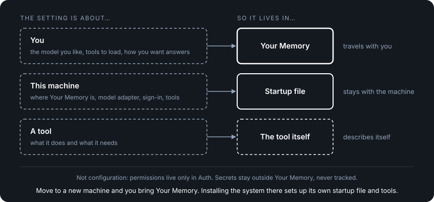

# Configuration

**Serves stories:** US-5, US-10, US-11 in the [PAA spec](../spec/personal-ai-architecture-spec.md).

## What configuration is

Configuration is the settings that tell your AI system how to run: which model to use, which tools are available, where your files are and how to reach outside services.

Most systems keep all of it in one place. Your preferences, server addresses, API keys, tool lists and feature flags are mixed together in a settings file that belongs to the app. Move to a new machine or a new product and half of it breaks, and your preferences stay behind.

We think that's lock-in nobody notices until they try to leave. Your choices about how your AI works are about you, so they should go wherever you go. And if switching providers means editing code, the promise that every part can be swapped isn't real.

So PAA splits configuration by what it's about. Your preferences (the model you like, the tools to always load, how you want answers) are your data, so they live in Your Memory. The few facts about this machine (where Your Memory is, which adapter connects to models, how sign-in works and where tools are installed) live in a small startup file that stays with the machine. Tools describe themselves, so nobody writes their definitions by hand.

That means your preferences come with you to a new machine or a new product, and switching a model, provider or tool is a settings change, never a code change.

<p align="center">
  
</p>

## How it works

Every setting answers one question: **is this about you, or about this machine?** Answer it the same way every time and nothing gets stranded when you move.

1. **Preferences travel.** They're files in Your Memory, read through the Memory tools like everything else. Move to a new machine and you bring Your Memory; installing the system there sets up its own startup file and tools. The system tries to honor your preferences and tells you about any it can't, such as a preferred tool that isn't installed there.
2. **The startup file stays thin.** It holds four facts about this machine and nothing about you. Every field in it is something you leave behind when you move, so it stays as small as possible.
3. **Tools describe themselves.** Adding a tool means installing it where the system looks; the tool tells the system what it does.
4. **Two things look like configuration but aren't.** Permissions live only in Auth, so no setting can widen or narrow access. Secrets like API keys stay outside Your Memory and out of anything git tracks; settings refer to them by name, never by value.
5. **You have the last word.** A product ships defaults, and you can change every one of them on your own hardware. An update replaces the product's defaults without overwriting your changes.
6. **Timing follows the split.** Machine facts are read once at startup, so changing them may need a restart. Your model and provider choice are read on every message, so switching either takes effect on the next one.

The rest of this doc is the specification: what any implementation of configuration must do.

---

## The Three Categories

Configuration looks like one thing but is actually three things, each with a different owner and a different home. Two other things are often mistaken for configuration and live elsewhere: **permissions** (who may do what) live only in Auth, and **secrets** live outside Your Memory in places git never tracks (see [Secrets](#secrets)).

### 1. Preferences — what you want

Your choices about how the system behaves. These are personal data. They describe you, not the environment.

| Example | Why it's a preference |
|---------|----------------------|
| "Always load git and filesystem tools" (always-send set) | Your workflow — meaningful anywhere |
| "I prefer Claude via OpenRouter" | Your model choice — honored wherever possible |
| "Verbose logging" | Your preference — not environment-specific |
| "Answer briefly, in British English" | Your interaction style — about how you work |

**Where they live:** Your Memory. They're data about you — no different from your documents, skills, or decisions. When you move to a new system, your preferences travel. The new environment tries to honor them. If it can't (tool not available, model not supported), the system tells you.

**What format:** Files in Your Memory. A config file in your library (e.g., `config/preferences.md` or `config/preferences.json`) — human-readable, editable, portable. The format is an implementation decision. The principle is architectural: preferences are personal data.

**What preferences are not:** permissions. "Allow the web scraper" or "deny system access tools" decides what an actor may do, so it lives in Auth and nowhere else ([auth-spec.md](./auth-spec.md)). Auth stores its records in its own way and manages them through Auth tools. Configuration never stores, reads, or applies permissions, and a preference never widens or narrows access.

### 2. Runtime config — what's here

The thin bootstrap that tells the system what exists in this environment. Exactly four fields. This is the "desk setup" — it describes the desk, not the person sitting at it.

| Field | What it is | Example |
|-------|-----------|---------|
| `memory_root` | Where Your Memory lives on this system | `/home/owner/your-memory` |
| `provider_adapter` | Which adapter connects to AI models | `openai-compatible` (generic default — works with OpenRouter, Ollama, OpenAI, Anthropic). Implementations may ship a provider-specific adapter instead. |
| `auth_mode` | How authentication works in this deployment | `local` (architecture default). Implementations may define other modes. |
| `tool_sources` | Where the system finds installed tools | `["/opt/your-ai/tools/", "/usr/local/mcp-servers/"]` |

Which model to use is intentionally not here — it is a preference (a product default or the owner's choice), not an environment fact. It lives in preferences in Your Memory.

**Example runtime config:**

```json
{
  "memory_root": "/home/owner/your-memory",
  "provider_adapter": "openai-compatible",
  "auth_mode": "local",
  "tool_sources": ["/opt/your-ai/tools/"]
}
```

**Where it lives:** With the deployment, not in Your Memory. A single file at a well-known path (e.g., `config.json` in the system root, or an environment variable pointing to it). It is created when the system is installed on this machine, from the product's defaults, and the owner can read and change it. How it is created (an installer, a setup screen, by hand) is an implementation choice. When you move to a new system, the new system provides its own runtime config. You never carry it.

**Why it's thin:** Every field that goes in runtime config is a field that can't travel with you. The thinner this file is, the less environment-specific your system becomes. Four fields is enough to bootstrap. Everything else is either a preference (in Your Memory) or discovered from the environment.

**The bootstrap prompt is not runtime config.** The one-line seed that tells the model where to start reading Your Memory (e.g., "Read AGENT.md for your instructions") belongs to the Agent Loop's own configuration — see [agent-loop-spec.md](./agent-loop-spec.md) §Boot-Time Configuration. It is not one of the four fields and not a preference. Everything the model learns after that seed comes from Your Memory.

### 3. Tool self-description — what tools can do

Tool definitions (name, description, parameters, capabilities) are not written by the owner or stored in config. **Tools describe themselves.**

| Mechanism | How it works | Example |
|-----------|-------------|---------|
| **MCP discovery** | Agent Loop connects to an MCP server and asks "what can you do?" | Filesystem tools, custom MCP servers |
| **Manifest file** | Tool ships with a JSON manifest describing its capabilities | CLI tool wrappers, native functions |
| **Built-in** | Definition is part of the Agent Loop or tool code | Memory tools |

**Where definitions live:** With the tools. An MCP server knows its own tools. A CLI wrapper ships with a `tool.json`. A native function is defined in code. The Agent Loop reads these at startup from the locations specified in `tool_sources`.

**Why this matters:** The tool says what it does. Adding a tool is: install it, point `tool_sources` at it, done. No definition to maintain, and no drift between config and tool.

---

## What Configuration Does NOT Do

| Anti-pattern | Why it's wrong | What to do instead |
|-------------|---------------|-------------------|
| Store tool definitions in config | Duplicates what the tool already knows about itself. Creates drift. | Let tools self-describe. Config just points to where tools are. |
| Store owner preferences in runtime config | Preferences are personal data. Putting them in runtime config means they don't travel with you. | Put preferences in Your Memory. |
| Store permissions in config or preferences | A second permission store can drift from Auth or bypass it. | Permissions live only in Auth. |
| Store secrets in Your Memory or tracked files | Secrets in tracked files get committed, shared, leaked. | Keep them outside Your Memory, somewhere git never tracks. Config references secrets by name (`$PROVIDER_API_KEY`), never by value. |
| Require config changes for normal operations | If using a new tool or starting a new project requires editing config, the system is too rigid. | Normal operations flow through Your Memory and tools. Config only changes when the environment changes. |
| Couple config to a specific implementation | Config that references internal service names, proprietary formats, or implementation details creates lock-in. | Config fields must be generic. `provider_adapter: "openrouter"` not `openrouter_v2_internal_bridge: true`. |

---

## Layered Overrides

Configuration is layered: the architecture, then the implementation, then the owner. Each layer can override the one below it. Last layer wins.

| Layer | What it provides | Example |
|-------|-----------------|---------|
| **Architecture — Foundation defaults** | Sensible defaults that make the system work out of the box | `auth_mode: "local"`, no tools pre-configured |
| **Implementation — Product defaults** | Opinionated defaults from the product built on the architecture | A product picks a provider adapter, ships starter tools, sets a default model |
| **Owner overrides** | The owner's choices, always final | Owner changes model, adds tools, changes the always-send set |

**Merge order is deterministic:** Architecture → Implementation → Owner. An owner override always wins. An implementation default applies unless the owner overrides it. An architecture default applies unless the product or owner overrides it.

**There is no layer above the owner.** On the owner's own hardware, no product rule beats the owner's choice. A product ships defaults, including safety-minded ones, and the owner can change every one of them. Rules the owner cannot change only make sense where someone else runs the hardware (hosting), which this architecture does not cover.

**Owner changes survive updates.** Product defaults and owner overrides are kept apart, so a product update replaces its own defaults without touching the owner's choices. Where an update conflicts with an owner change, the owner is told; the change is never overwritten silently. How a product keeps the two apart is an implementation choice.

**Preferences use the same layering:** The Architecture has no preferences (the foundation is unopinionated). Implementations ship product defaults ("default to a fast model"). Owner preferences are the owner's choices ("use the larger model"). The owner wins.

---

## Secrets

Secrets (API keys, tokens, credentials) live anywhere outside Your Memory that git never tracks: environment variables, an untracked config file (such as a gitignored `.env`), or a secret store. Which one is an implementation choice.

| Principle | Detail |
|-----------|--------|
| **Reference, never value** | Config refers to secrets by name: `$PROVIDER_API_KEY`. The value comes from wherever the deployment keeps secrets. |
| **Never in Your Memory** | Your Memory is portable, shareable, versioned. Secrets in Your Memory are secrets leaked. |
| **Never in tracked config** | Runtime config and adapter config may be shared across deployments or checked into a repo. They hold references only. |
| **Not portable** | Secrets do not travel with Your Memory. On a new system, the owner sets them up again. |

---

## Adapter Config

Each adapter (see [adapter-spec.md](../architecture/adapter-spec.md), D139) may have its own config file. This is where provider-specific settings live — not in runtime config, not in preferences.

| Adapter (one per format) | What its config contains | Example |
|---------|------------------------|---------|
| **OpenAI-compatible adapter** | Provider profiles (OpenRouter, Ollama, OpenAI and others), each with a base URL and, when the provider needs a key, a secret reference; plus the default profile | `adapters/openai-compatible.json` |
| **A provider's own format** (for example Anthropic's) | Base URL, API version, secret reference | `adapters/anthropic.json` |

**Example adapter config** (`adapters/openai-compatible.json`). It lists provider profiles and pins no model, since the model is a preference:

```json
{
  "provider_profiles": {
    "openrouter": {
      "base_url": "https://openrouter.ai/api/v1",
      "api_key_env": "OPENROUTER_API_KEY"
    },
    "local": { "base_url": "http://127.0.0.1:11434/v1" }
  },
  "default_provider_profile": "openrouter"
}
```

**Example preferences** (in Your Memory), the owner's active choices beside each other:

```json
{
  "model": "anthropic/claude-sonnet-4-6",
  "active_provider_profile": "openrouter"
}
```

**An adapter config can list provider profiles.** One adapter format (for example OpenAI-compatible) often reaches several providers. The adapter config may list each as a profile with its endpoint and a secret reference; which profile is active is an owner preference in Your Memory, read on every message like the model (D193). Switching between profiles is a preference change with no restart. Only a provider in a new format needs a new adapter, named by `provider_adapter`.

**Swapping to a new adapter format = swapping an adapter file.** Runtime config points to which adapter (`provider_adapter: "openrouter"`). The adapter file contains everything provider-specific. Nothing else in the system knows or cares about provider details. See [adapter-spec.md](../architecture/adapter-spec.md) §How Model Configuration Works in Practice for the full walkthrough of model and provider swaps — what changes, what doesn't, and the two kinds of change (same provider vs different provider).

This is the same pattern as the architecture's contracts: components speak a generic internal interface, adapters translate to/from the specific external standard. Configuration follows the same principle: runtime config speaks generically, adapter config handles the specifics.

---

## How the System Boots

Configuration is read at two different times. **Environment facts are read once, at startup.** **The owner's model and provider choice are read on every message.** Everything else in this section follows from that split.

### At startup

The system reads environment configuration in a strict sequence. Each phase depends only on the previous phase — no circular dependencies.

1. **Load runtime config** — find the config file (well-known path or env var), read the four fields. Now the system knows: where's Your Memory, which adapter, what auth mode, where are tools.
2. **Load adapter config** — load the adapter file specified by `provider_adapter`. Now the system knows how to connect to models.
3. **Discover tools** — scan `tool_sources` paths. For each tool found: MCP servers announce their tools via protocol, manifest files are read, built-in tools are loaded from code. Now the system knows what tools are available, including the Memory tools.
4. **Mount Your Memory** — use `memory_root` to locate Your Memory. Components reach it only through the Memory tools, like every other read and write. No component reads Memory files directly.
5. **Ready** — the Gateway starts accepting connections (see [gateway-agent-loop-contract.md](../architecture/gateway-agent-loop-contract.md) for request flow).

Changing runtime config, adapter config, or installed tools changes the environment. A system may need a restart (or a hot-reload, if it supports one) to pick these up. That is still a config-only change.

### On every message

1. **Gateway reads the owner's current model and provider choice** from preferences in Your Memory, through the Memory tools.
2. **Gateway passes them to the Agent Loop** with the request, after Auth has checked the request.
3. **Agent Loop calls the model** through the Model API using that model, that provider profile and the loaded adapter.
4. **Gateway stores the reply** with the model and provider that produced it (D194).

Because the model and provider choice travel with each request, a change takes effect on the next message — no restart, no code change. If the chosen model isn't available through the loaded adapter, the owner is told rather than silently switched.

Other preferences are also read through the Memory tools; how often to re-read them is the implementation's choice.

If any preference references a tool that doesn't exist in this environment (e.g., "always load web scraper" but no web scraper is installed), the system notes the mismatch and continues. The model will tell the owner "web scraper is configured as preferred but not available in this environment" when relevant. This is not an error — it's information.

Permissions are not part of either sequence. The Gateway asks Auth on every request, and the Agent Loop asks Auth before each tool call ([auth-spec.md](./auth-spec.md)). Configuration never applies access rules.

---

## The Anti-Lock-In Test (D147)

**A normal swap must succeed with config-only changes — zero code edits.**

Three swap types constitute "normal":

| Swap | What changes | Config changes required |
|------|-------------|----------------------|
| **Provider swap** (profile in the loaded adapter) | OpenRouter → Ollama, both listed in the OpenAI-compatible adapter config | 1. Active provider preference in Your Memory. Next message uses the new provider; no restart (D193). |
| **Provider swap** (new adapter format) | OpenRouter → a provider with its own format | 1. `provider_adapter` in runtime config. 2. New adapter config file. 3. API key secret. A restart is allowed. |
| **Model swap** (within adapter) | Claude → Gemini (both on OpenRouter) | 1. Model preference in Your Memory. Next message uses the new model; no restart. |
| **Tool swap** | Add/remove a tool | 1. Install/uninstall the tool in a `tool_sources` path. 2. Update preferences if it was in the always-send set. |

**The test, concretely (CI-ready):**

1. Start the system with provider A (e.g., OpenRouter)
2. Run a standard conversation + tool-call test suite — verify pass
3. Change `provider_adapter` to provider B, provide adapter config, set the secret
4. Run the same test suite — verify pass
5. **If any code change was required between steps 2 and 4, the test fails.** Lock-in has been introduced.

This is a CI test, not a guideline. Run it on every release.

---

## Configuration and Your Memory: The Line

**One question: is this about you, or about this desk?**

- "I prefer Claude" → about you → Your Memory
- "Claude is available at this API endpoint" → about this desk → runtime/adapter config
- "Always load git tools" → about you → Your Memory
- "Git tools are installed at /usr/local/bin/git" → about this desk → tool self-description
- "Auth uses local mode" → about this desk → runtime config
- "This actor may write files" → a permission → Auth, nowhere else
- "sk-abc123..." → a secret → outside Your Memory, never tracked by git

**Your Memory stays clean of environment-specific references.** When you move, your preferences come with you. The new environment provides its own runtime config, its own adapter config, its own installed tools. The system matches your preferences against what's available and tells you about any gaps.

---

## Decisions Made

| # | Decision | Rationale |
|---|----------|-----------|
| D143 | Configuration is a cross-cutting concern — not owned by any single component, defined in its own spec | Every component has configuration, and it is where lock-in hides. Three categories: preferences (Your Memory), runtime config (thin bootstrap), tool self-description. |
| D147 | Anti-lock-in test: three normal swaps (provider, model, tool) must succeed with config-only changes | Provider swap = change the provider preference (D193), or for a new format change adapter + secret. Model swap = change preference. Tool swap = install/uninstall + update preferences. If any requires code changes, lock-in has been introduced. CI-testable on every release. |

---

## Success Criteria

- [ ] Switching to another provider profile in the loaded adapter takes effect on the next message — no restart, no code change (D193)
- [ ] Swapping to a provider in a new format requires only changing `provider_adapter`, providing a new adapter config file, and setting the secret — zero code changes
- [ ] Changing the model preference takes effect on the next message — no restart, no code change
- [ ] Swapping the Agent Loop requires only changing the Agent Loop binary/container — runtime config, preferences, and Your Memory are unaffected
- [ ] Adding a tool requires only installing it in a `tool_sources` path — the tool self-describes, no config editing beyond that
- [ ] Moving Your Memory to a new system works: preferences travel, runtime config is provided by the new environment, tool mismatches are reported not errors
- [ ] The owner can override every product default on their own hardware, and an update never silently overwrites an owner change
- [ ] Runtime config has exactly four fields
- [ ] No permission is stored in or applied from configuration or preferences
- [ ] An AI agent can read and understand every config file without documentation

---

## Security Requirements

Per-component requirements from [security-spec.md](./security-spec.md). Security-spec owns the "why"; this section owns the "what" for Configuration.

- [ ] Secrets (API keys, tokens, credentials) must never be stored in Your Memory or in any file git tracks — environment variables, untracked config files, or a secret store only
- [ ] Runtime and adapter config must not contain secrets by value — only references (`$PROVIDER_API_KEY`)
- [ ] Preferences in Your Memory must not contain environment-specific references (server addresses, ports, paths) — only personal choices
- [ ] Adapter config files must not leak across deployments — provider-specific settings stay with the deployment, not with Your Memory
- [ ] Startup must not require network access — the startup phases complete without any outbound calls

---

## Contract alignment

The canonical contract tree under `contracts/` is authoritative for exact runtime,
adapter, message, and internal-handoff shapes. The model and provider choice are carried by the
internal request, while the bootstrap prompt, provider adapter, and tool definitions
remain startup configuration. Adapter configuration remains intentionally
implementation-specific until a dedicated schema is agreed.

---

*Configuration is where lock-in hides. The architecture promises zero lock-in at every level — but if configuration quietly introduces dependencies, proprietary formats, or environment coupling, the promise is hollow. This spec exists to make sure the desk setup is as simple and swappable as everything else.*
