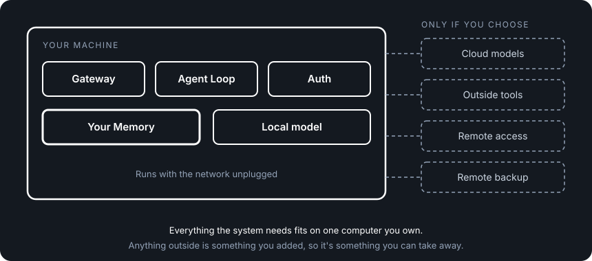

# Deployment

**Serves stories:** US-1, US-9, US-11 in the [PAA spec](../spec/personal-ai-architecture-spec.md).

## What deployment is

Deployment is where your AI system runs: which computer it lives on, what it needs to start, and what it reaches beyond that computer.

Most AI systems decide that for you. Your memory, your conversations and the AI itself live on the company's servers, on hardware you'll never touch. If you want to run it yourself, you can't, because it assumes their cloud, their database and their network. Leaving means starting over.

We think a system you can only run on someone else's computer isn't really yours. Owning your memory and swapping any part are promises on paper until you can run the whole thing on a machine you control.

So PAA guarantees the system can always run on hardware you physically control, such as your laptop, desktop or home server, and keep working with the internet unplugged. Cloud models, outside tools, hosting and remote access are all allowed, but they're choices you make, not things the system needs. Nothing leaves your machine unless you set it up to.

That makes every other choice a real one. You can use the best cloud model today and switch to a local one tomorrow, and if a company you depend on disappears, the system keeps running. You can check it yourself by unplugging the network cable.

  

## How it works

This works because the architecture assumes nothing exists beyond your machine. Anything outside it is something you added, so it's something you can take away.

1. **One machine, one install.** The four components and two APIs install and start together on an ordinary computer (8 GB of RAM; Linux, macOS or Windows). You can spread them across machines, but you never have to.
2. **Works offline.** With no internet, the whole loop still runs: your message goes to a local model, tools run, and the reply comes back. The model may be less capable, but the system works.
3. **Nothing leaves unless you say so.** Your Memory, conversations, sign-in data and settings stay on your machine. By default the system only answers requests from that same machine; reaching it from anywhere else is something you set up.
4. **Every dependency has a way out.** The system still depends on outside things, like a model provider or the way it's packaged. For each one, the spec names the way out: changing provider is a settings change, and containers are optional packaging around ordinary programs.
5. **You can check and keep what you run.** You can verify the software is the genuine release. Updates never put your data at risk and can always be rolled back, and you can read Your Memory with ordinary tools even when the system isn't running.

The rest of this doc is the specification: what any implementation of deployment must do.

---

## What this covers

The architecture defines one deployment: the whole system on hardware the owner physically controls (D148). Every other way to run it is an implementation choice layered on top, and none of them may remove the local path.

### What it does not cover

These are out of scope for the architecture. Implementations address them.

| Topic | Why it's not Architecture |
|-------|---------------------|
| **Managed hosting** | A product decision — "we run it for you" is an opinion on deployment, not a deployment contract (D148) |
| **VPS / cloud self-hosting** | Deployment on hardware you don't physically control is an implementation concern |
| **Remote access** | Accessing the system from outside your local network requires network exposure, which is a product/security decision |
| **Update mechanics** | How updates are delivered and applied is implementation-specific |
| **Backup and restore** | A product feature, not a deployment contract |
| **Multi-instance** | Running multiple instances on one machine is a product pattern |
| **System lifecycle** | Startup sequences, crash recovery, auto-restart are operational details |
| **Data boundaries** | What data is allowed to leave the machine is a security concern (see [security-spec.md](./security-spec.md)) |

## The Deployment Contract

Five guarantees that any valid deployment of the Personal AI Architecture must honor.

### 1. Runs on hardware you control

The system must run on a computer the owner physically controls. No remote service is required to start, operate, or shut down the system. "Physically controls" means the owner has root/admin access to the machine and can inspect, modify, or disconnect it at any time. The local deployment path must always exist — additional deployment options are implementation conveniences layered on top.

### 2. Functions fully offline

The system must be capable of operating with zero internet connectivity. This means:

- The system starts without network access
- The Agent Loop connects to a model through the Model API — that model can be local
- Tools execute without requiring external services (tools that call external APIs are optional additions, not requirements)
- Your Memory is fully accessible
- Auth works locally

The contract requires that **a fully offline path exists** — not that every deployment is offline. An owner who uses cloud models is making a valid choice, but the architecture must never require it.

What "functional" means: the full agent loop completes (message → model → tool calls → response) without internet or other non-loopback network traffic. The model may be less capable. The tool set may be smaller. But the system works.

### 3. Data stays local by default

Your Memory, conversations, auth data, and configuration are stored on the local machine. Nothing leaves the machine — no outbound network calls on startup or during operation — unless the owner has explicitly configured it: a cloud model provider, an external tool, a remote backup.

### 4. Runs on modern consumer hardware

The system must run on hardware that a typical person already owns:

| Requirement | Minimum |
|-------------|---------|
| **CPU** | x86_64 or ARM64 |
| **RAM** | 8 GB (system only — local models may need more) |
| **Storage** | 1 GB for the system + space for Your Memory |
| **OS** | Linux, macOS, or Windows |

Local models have their own hardware requirements (RAM, GPU) that are outside this contract — they depend on which model the owner chooses. The system itself must not impose hardware requirements beyond what's listed above.

### 5. Single deployable unit by default

All four components (Your Memory, Agent Loop, Auth, Gateway) and both APIs (Gateway API, Model API) deploy together on one machine as a single unit. One install, one start command, one thing to manage.

Splitting components across machines is allowed but not required — the single-unit deployment is the default. Split patterns are an implementation concern.

## Network Posture

The system listens on **the loopback interface only** by default: `127.0.0.1` and/or
`::1` are valid localhost bindings. No wildcard or network address is exposed unless
the owner explicitly configures it. No particular IP address family is required.

This means:

- The Gateway API listens on `localhost:PORT` — accessible only from the same machine
- No UPnP, no automatic port forwarding, no discovery broadcasts
- External access (LAN, internet) requires the owner to explicitly configure port binding, reverse proxy, or tunnel

This is a security default, not a limitation.

## Storage Contract

Everything the system stores (Your Memory, conversations, auth data and configuration) lives on the local machine and survives a restart and an update. Which storage technology holds it is an implementation choice: a filesystem for Your Memory, a database such as SQLite for conversations, and Git for version history are one way to do it.

What Your Memory itself must support (read, write, search, and version history with restore) is defined in [memory-spec.md](./memory-spec.md). This contract does not repeat or extend it.

One additional constraint: **Your Memory must be inspectable without the system running.** The owner must be able to read their own data using standard tools (text editor, file browser, database viewer) — not just through the system's APIs. This prevents storage implementations from making data opaque or proprietary. A future implementation could use a different storage backend (encrypted filesystem, structured database) as long as the owner retains the ability to inspect and extract their data independently of the system.

## External Dependencies

The system has external dependencies. Zero-lock-in doesn't mean zero dependencies — it means no dependency is inescapable. For each critical external dependency, the contract defines an escape path.

### Critical Dependencies

These are dependencies that could prevent the system from functioning if they disappeared.

#### Model Provider

**What it is:** The system needs an AI model to function. Models are accessed through the Model API via adapters (see [adapter-spec.md](../architecture/adapter-spec.md)).

**The dependency:** Whether local (Ollama, llama.cpp) or cloud (OpenRouter, Anthropic), the owner depends on a model provider.

**Escape path:** The Model API adapter pattern makes switching providers a config change, not a code change (D147). Cloud to cloud, cloud to local, local to local — if the loaded adapter lists both as provider profiles, the swap cost is one preference change with no restart (D193); a provider in a new format costs one adapter file plus the runtime config field and its secret, and a restart is allowed. No single provider can hold the system hostage because the architecture is designed to swap between them. The offline contract (guarantee #2) ensures a local path always exists.

**Lock-in risk:** Low — architectural. The adapter pattern eliminates protocol lock-in. The remaining risk is capability lock-in (a weaker local model can't do what a cloud model can), which is an industry constraint, not an architecture constraint.

#### Container Runtime

**What it is:** Containers (OCI-compatible, such as Docker) are one supported way to package and run the system. They are not the architecture's default, and the architecture does not require them. An implementation may ship container images, native installers, or plain programs; choosing one is a packaging decision.

**The dependency:** Only when an implementation chooses container packaging. Then running it requires a container runtime.

**Escape path:** The system is software that can run in containers — it is not a container-native application. The components are standard programs (HTTP servers, file I/O) that run natively without containers. Containers are packaging, not architecture.

**Lock-in risk:** Low — packaging. OCI is an open standard with multiple runtimes (Docker, Podman, containerd). No container-specific features (orchestration, service mesh) are used.

### Non-Critical Dependencies

These affect capability but not function.

| Dependency | What it provides | Without it |
|-----------|-----------------|------------|
| **Internet connectivity** | Access to cloud model providers, external tool APIs, package updates | System runs fully offline with local models and local tools |
| **MCP protocol** | Default tool communication standard | Tools can use manifest files or native function interfaces. MCP is default, not required (D32). |
| **A programming language runtime** | Whatever language an implementation is written in | The architecture is language-agnostic. Implementations in any language honor the same contracts. |

## Software Trust

You control the hardware — but you also need to trust what's running on it. The deployment contract requires that the owner can verify the software is authentic and untampered. It does not prescribe the mechanism.

Possible mechanisms (implementation decisions, not contract requirements):
- Signed container images with verifiable signatures
- Published checksums for release artifacts
- Reproducible builds from open source code

If you can't verify what you're running, you can't trust what you're running. Open source (the code is readable) is necessary but not sufficient — you also need to know that what you're running matches what you read.

## Update Principles

Updates must never compromise the owner's data or control. Two principles — mechanics are implementation-specific.

1. **Never risk data loss.** Your Memory, preferences, conversations, and auth data must survive any update. An update that could destroy or corrupt owner data is a broken update.

2. **Always reversible.** If an update breaks the system, the owner must be able to return to the previous working state. The previous version must remain available and the owner's data must be compatible with it.

## Checking an implementation

- [ ] The system starts and completes a full agent loop (message → model → tool → response) on a machine with no internet connectivity, using a local model
- [ ] The system runs on Linux, macOS, and Windows on modern consumer hardware (8GB RAM, x86_64 or ARM64)
- [ ] No outbound network calls (beyond localhost/loopback) occur during startup unless the owner has configured a network-dependent component (e.g., cloud model provider)
- [ ] *(security)* The Gateway API is not reachable from other machines on the network in the default configuration
- [ ] Your Memory is stored on the local machine and is inspectable without the system running using standard tools (text editor, file browser, database viewer)
- [ ] Swapping from a cloud model provider to a local model provider requires only configuration changes — no code changes (per D147)
- [ ] The system runs as a single deployable unit with a single start command
- [ ] An update to the system does not modify, delete, or corrupt any existing Memory, preference, or conversation data
- [ ] No outbound network calls occur during operation except to destinations the owner has configured (e.g., a cloud model provider, an external tool, a remote backup)
- [ ] *(security)* The owner can verify that the software they are running is the genuine, untampered release (the mechanism is the implementation's choice)
- [ ] If an update breaks the system, the owner can return to the previous working version, and their data still works with it

## Decisions

| # | Decision | Rationale |
|---|----------|-----------|
| D22 | Auth on both local and managed hosting | Auth is a memory concern (who can access your system), not a hosting concern. Even local deployments need auth for remote access and more than one actor. |
| D29 | Zero lock-in by design | No part of the architecture requires a dependency the owner can't escape. Where lock-in risk remains, it comes from how an implementation is built or from limits of the industry, like a weaker local model, never from the architecture. The deployment contract enforces this at the infrastructure level. |
| D148 | The architecture defines local deployment only | The architecture defines how the system runs on hardware the owner controls. Managed hosting, VPS and cloud hosting are product offerings. |
| D173 | Containers are one supported way to run the system, not the default | Packaging is an implementation choice. The architecture must run with no licence activation. |
