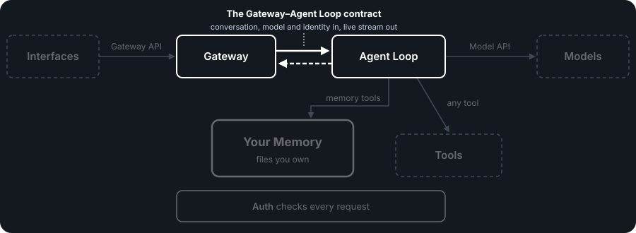

# The Gateway–Agent Loop Contract

**Serves stories:** US-5, US-6, US-7 in the [PAA spec](../spec/personal-ai-architecture-spec.md).

## What this contract is

This contract is the agreement between your system's front door and its hand. It covers how the Gateway passes a request to the Agent Loop, and how the Agent Loop sends the results back.

In most AI products, the part that receives your messages and the part that runs the AI are written together, by the same team, as one piece of code. They share data structures and assumptions nobody wrote down. That works until you want to replace one of them, and then you find the other depends on all of it.

We think the handoff between them should be written down, even though both parts live inside your system. Otherwise you can't swap one without the other, and the Agent Loop, the part that will keep improving, stays stuck to the Gateway.

So PAA defines this one handoff as a small, plain contract. The Gateway sends the conversation, the model to use and who is asking, and the Agent Loop streams back the reply, the tools it used, and when it's done. It isn't a third API. The two APIs are where outside things plug in: client apps and models. This is an internal agreement between two parts of your own system, kept as simple as it can be.

That means you can replace the Agent Loop without touching the Gateway, or the Gateway without touching the Agent Loop. Each only has to honor the same small agreement.

<p align="center">
  
</p>

## How it works

This works because the handoff only needs to carry a few things. A review of every possible connection in the system found that all the others already go through something that exists, such as a tool, an API, configuration or Auth's own interface. This was the only one left to define (D136).

- **What goes in:** the conversation so far plus the new message, the model and provider profile to use, who is asking (the identity Auth confirmed), and a little context, such as an ID for tracing the request. Anything that doesn't change between messages, like the starting instructions, the tools and the adapter with its provider profiles, is set up in the Agent Loop once rather than sent every time.
- **What comes back:** a live stream: text as the model writes it, each tool call and its result, and a final "done." Client apps can show what's happening as it happens.
- **Auth at both ends:** the Gateway checks every request with Auth before handing it over, and the Agent Loop checks with Auth before every tool call.
- **Same for every trigger:** a message from you, a webhook from another service and a scheduled job all arrive in the same shape. A label says which it was, but the Agent Loop doesn't need to treat them differently.
- **Errors:** if something fails before work starts, the Gateway gets a plain error straight away. If it fails partway, the stream says so and closes.
- **No adapter needed:** both sides are parts of your own system and speak the same internal language, so there's nothing to translate. A replacement Agent Loop just has to honor this contract. If one you want to use doesn't, a small translator in front of it, the same idea as an adapter, can make it fit, and the Gateway still doesn't change.

**What it deliberately leaves out:** routing, version numbers and message wrappers. It can run over the network or as a plain function call inside one program, without changing its shape.

The rest of this doc is the specification: what any implementation of the Gateway–Agent Loop handoff must do.

---

## What the contract covers

One internal handoff: the Gateway passes a request to the Agent Loop, and the Agent Loop streams results back (D137). It is not a third API. The Gateway API and Model API are the boundaries external things plug into; this is an internal contract between two components inside one deployment. It exists so either one can be swapped without the other (FS-5, FS-7).

The design rule is **the simplest contract that fills the one gap** (D136): one endpoint, one stream format, an Auth check before every request. The canonical internal path is `POST /agent-loop/chat`. The Gateway POSTs a request; the Agent Loop returns a Server-Sent Events stream. The Gateway calls Auth on every request before it POSTs, and the Agent Loop asks Auth before each tool call.

```
Client → Gateway API → Gateway → POST /agent-loop/chat → Agent Loop → Model API → Model
                          ↓                               ↓
                   Auth (every request)          Auth (each tool call) → Tools
```

## The request

```json
{
  "messages": [
    { "role": "user", "content": [{ "type": "text", "text": "Help me plan my finances" }] },
    { "role": "assistant", "content": [{ "type": "text", "text": "I'll read your finance page..." }] },
    { "role": "user", "content": [{ "type": "text", "text": "Focus on budgeting" }] }
  ],
  "model": "local/llama-3.1-8b",
  "provider": "local",
  "metadata": {
    "conversation_id": "conv_abc123",
    "correlation_id": "req_xyz789",
    "trigger": "message",
    "client_context": { "path": "/finances" }
  }
}
```

**Messages** follow the industry-standard `role` + `content` format (consistent with D16: use the prevailing standard, not a custom protocol). All three contracts (Gateway API, this contract, Model API) use one message shape, defined in `contracts/schemas/message.json`:

- **Content is a list of parts.** Text comes first; images, files and other types are further parts. The canonical contract has no string shorthand.
- **Tool calls and tool results are ordinary parts of messages.** An assistant message can carry the text the model wrote and the tool calls it made; a tool message carries a tool result. They are saved in full in conversation history. On resume the Gateway selects a model-sized working context; any message it selects is sent unchanged, with tool-call/result relationships intact.

The Gateway packages this array from two sources:

1. **Selected conversation history** — complete older turns chosen from Your Memory for this model call, via the Gateway's conversation store tool (D152); the full stored record remains available to clients
2. **Current message** — from the client request

The bootstrap prompt (the short system message that tells the model to read Your Memory) is not in the request. It is part of the Agent Loop's own configuration, and the Agent Loop puts it first when it calls the model.

**Model and provider.** Every request also carries the model to use and the owner's active provider profile. The Gateway reads both choices on every message and passes them here, so a changed choice applies to the next message with no restart of either component.

**Optional context summary.** The Gateway may deterministically extract a bounded summary from omitted older turns without calling a model. It sends the derived text separately as `context_summary`, with its source and omitted-turn count. The summary is derived data for content separation, not a saved conversation message or an instruction. The Agent Loop renders it as a labelled, ephemeral `user`-role context message before selected history when preparing the Model API call. The label identifies the Gateway as its author and says it is not a new owner request. The bootstrap remains the only system message.


**Metadata** is pass-through context. The Agent Loop can use it or ignore it.

| Field | Description | Required |
|-------|-------------|----------|
| `messages` | Model-sized working context: selected complete history (including associated tool calls and results) and unchanged current message | Yes |
| `context_summary` | Optional Gateway-generated deterministic summary of omitted older turns; distinct from saved messages and rendered as labelled, ephemeral context for the model | No |
| Model | The model to use for this request, from the owner's current choice | Yes |
| `provider` | The owner's active provider profile (D193) | Yes |
| `auth_context` | The authenticated identity Auth returned for this request: actor, authentication ID, timestamps and correlation ID; never credentials or permissions | Yes |
| `metadata.conversation_id` | Which conversation this belongs to | No (Agent Loop doesn't need it — Gateway tracks this) |
| `metadata.correlation_id` | Request trace ID, generated by Gateway | Yes |
| `metadata.trigger` | `"message"` \| `"webhook"` \| `"schedule"` | No (default: `"message"`) |
| `metadata.client_context` | Client-provided context (path, folder) | No |

**What is NOT in the request** — the Agent Loop is pre-configured with:

- **Bootstrap prompt** — the short system message that tells the model to read Your Memory
- **Tool definitions** — which tool sources (MCP servers, CLI tools, native functions), which tools are always-send (D109)
- **Provider configuration** — provider adapter, API key reference, base URL
- **Optional implementation bounds** — implementations MAY pass a `maxIterations` safety bound. This is an optional, implementation-provided parameter with no default. The Agent Loop itself does not impose an iteration cap — it loops until the model signals completion. If an implementation provides `maxIterations`, that is the implementation's deployment choice, not an architectural constraint.

These are Agent Loop startup configuration, not per-request data. They don't change between requests. The model and the active provider profile are not in this list: they travel with each request.

### Trigger types

Every trigger produces the same request shape and the same `messages` array. `metadata.trigger` records which it was, but the Agent Loop does not need to branch on it.

| Trigger | How it enters | Example message |
|---------|--------------|-----------------|
| Client message | Client → Gateway API → Gateway | `"Help me plan my finances"` |
| Webhook | External service → Gateway API → Gateway | `"New email received: [subject]"` |
| Schedule | Cron tool → Gateway | `"Run the daily digest"` |

All triggers flow through the Gateway. Even scheduled triggers create conversations (the daily digest produces output the owner can review).

---

## The response stream

The response is a Server-Sent Events stream. Always streaming — no non-streaming mode. Callers who want the complete response collect the stream.

```
event: text-delta
data: {"_event_type":"text-delta","content":"Hello, I'll help with budgeting."}

event: tool-call
data: {"_event_type":"tool-call","id":"tc_1","source_id":"mcp:filesystem","name":"read_file","arguments":{"path":"/finances/AGENT.md"}}

event: tool-result
data: {"_event_type":"tool-result","id":"tc_1","output":"# Finances\nBudget goal: ..."}

event: text-delta
data: {"_event_type":"text-delta","content":"Based on your finance page..."}

event: done
data: {"_event_type":"done","finish_reason":"stop","usage":{"prompt_tokens":150,"completion_tokens":75}}
```

### Events

| Event | When | Data |
|-------|------|------|
| `text-delta` | Model generates text | `{ content }` |
| `tool-call` | Model initiates a tool call | `{ id, source_id, name, arguments }` |
| `tool-result` | Tool execution completes, or the call did not run | `{ id, output }` on success; `{ id, error, error_code? }` on failure, where the optional `error_code` is `not_permitted`, `tool_error` or `auth_unavailable` |
| `approval-request` | A product approval rule covers a tool call (optional) | `{ request_id, tool_name, summary, status: pending, created_at, expires_at }` |
| `approval-result` | The approval was decided (optional) | `{ request_id, decision, decided_at }`, where `decision` is `approved`, `denied`, `cancelled` or `expired` |
| `done` | Agent loop complete | `{ finish_reason, usage? }`, where the optional `usage` has `prompt_tokens` and `completion_tokens` |
| `error` | Unrecoverable failure mid-stream | `{ code, message }` |

Every event's data also carries an `_event_type` field naming the event. `contracts/openapi/gateway-engine.yaml` has the full shapes, including optional fields.

Tool calls are visible in the stream because:
- Clients use them for status display ("Reading file...", "Searching library...")
- Products that add approval prompts can show the owner a tool call before it runs (whether to ask is the product's choice)
- Observability — the full interaction is traceable

When Auth refuses a tool call, the Agent Loop does not run it and returns a `tool-result` error saying the call was not permitted, so the model can tell "not permitted" apart from "failed".

The Agent Loop may call the model multiple times in one stream (model calls tools, Agent Loop executes them, sends results back to model, model continues). This multi-turn loop is internal to the Agent Loop — the stream captures everything that happens.

---

## Errors

### Pre-Stream Errors (HTTP Status Codes)

The request never started processing. No SSE stream opened.

| Code | When |
|------|------|
| 400 | Invalid request — missing messages, bad format |
| 401 | The identity context (`auth_context`) is missing, malformed, expired or caller-supplied |
| 503 | Agent Loop unavailable |

Response body: `{ "code": "...", "message": "..." }`, plus the request's correlation ID.

### Mid-Stream Errors (SSE Error Events)

The stream started, then something failed.

| Code | When |
|------|------|
| `provider_error` | Model unreachable or timeout |
| `tool_error` | Tool failed and model cannot recover |
| `auth_error` | Auth denied the request or could not check it |
| `context_limit_unknown` | No safe context limit is known for the selected provider and model; no model call is made |
| `context_overflow` | The selected model call cannot fit its context window, including a continuation with live tool results |

The Agent Loop must classify errors correctly — no catch-all error code. Recoverable tool failures (a tool returns an error result) go back to the model as `tool-result` events for the model to decide what to do. Only unrecoverable tool infrastructure failures emit `tool_error` and close the stream.

**Conversation ordering and persistence:** The Gateway permits only one active Agent
Loop turn for a conversation. Later messages queue in arrival order; different
conversations may run concurrently. The Gateway persists the incoming message
before dispatch when possible. If the stream later fails, it retains all observed
assistant text, tool calls, tool results, and the terminal error as an incomplete
turn. It does not report a successful completion. If initial persistence fails,
the Gateway does not dispatch the turn.

**Error message safety:** The `message` field in error events must be safe for client display. Never forward raw `Error.message`, stack traces, or file paths. Map each error code to a fixed safe message. Log raw diagnostic detail to structured stdout only. See Security Requirements below.

Every error, whether an HTTP response or an SSE error event, carries the request's correlation ID, so a failure can be traced to the request that caused it ([communication-principles.md](./communication-principles.md) P2, P5).

After an `error` event, the stream closes. The Gateway decides how to communicate the failure to the client.

---

## Auth at both ends

Auth is a separate component, not part of the Gateway or the Agent Loop (D60). Permissions live only in Auth. It is called at two points:

1. **Every request.** The Gateway calls Auth before it POSTs to the Agent Loop. Auth validates the request (token, session, API key) and identifies the actor. The Gateway attaches the canonical transport-neutral `auth_context` returned by Auth or rejects the request with HTTP 401. Permissions remain in Auth and are not carried in the context.
2. **Each tool call.** Before running a tool call, the Agent Loop asks Auth whether this actor may make it. A refused call is not run; the model is told it was not permitted. If Auth can't be reached, the call is not run either: the system fails closed (see [auth-spec.md](./auth-spec.md) "Auth unavailable").

The Agent Loop receives a pre-authenticated `auth_context` through the internal transport adapter. The adapter verifies the Gateway-to-Agent-Loop boundary and rejects a missing, malformed, expired, or caller-supplied context. The Agent Loop never authenticates credentials itself and never decides permissions: it asks Auth and honours the answer.

---

## Cancellation

`POST /agent-loop/cancel` targets an active turn by `correlation_id`. The Gateway
sends `reason=auth_revoked` when Auth revokes the actor. The Agent Loop cancels
supported in-flight work, starts no further model or tool work, and closes the
matching stream with `auth_error`. Cancellation is cooperative at the internal
boundary; tool implementations must not commit writes after cancellation is
observed. Repeating cancellation is idempotent and returns `accepted`,
`already_finished`, or `not_found`.

---

## Approvals

Approval prompts remain a product choice; the architecture default is that the owner can do everything. When a product enables an approval rule, the Agent Loop emits the canonical `approval-request` event and does not execute the covered call while it is pending. The client submits the canonical decision through the normal Gateway API; the Agent Loop may continue in a new stream. `approved`, `denied`, `cancelled`, and `expired` are terminal outcomes keyed by `request_id`; duplicate decisions are idempotent and cannot replay execution. Auth must authorize the decision maker.

---

## What the contract leaves out

These were considered in the protocol evaluation and found unnecessary for this interface:

| Excluded | Why |
|----------|-----|
| Routing / capability matching | One Agent Loop. No discovery needed. |
| Node registration | Components are fixed, not dynamic. |
| Intent-based routing | The Agent Loop (with the model) decides what to do. |
| Operating modes | The Agent Loop handles complexity internally. |
| Workflow orchestration | The Agent Loop orchestrates via tools. |
| Protocol versioning | Not needed: the contract changes additively ([communication-principles.md](./communication-principles.md) P6). New fields are added alongside existing ones and ignored by components that don't know them, so the Gateway and Agent Loop can update on their own schedules. Until GAP-PAA-31 is resolved, some schemas still reject unknown fields, so this is the intended model rather than a current guarantee. A breaking change is the rare exception, and needs both sides updated. |
| Envelope format (CloudEvents, BDP) | Marginal value for a single internal endpoint. The request body IS the contract. |

---

## Conventions

Agreed formats that are not contractually required — adoptable incrementally. Correlation ID is **not** listed here because it is a required contract field (`metadata.correlation_id`, see request table above) and a security requirement (end-to-end traceability).

| Convention | Implementation |
|------------|---------------|
| **Error format** | `{ code: string, message: string }` — consistent across HTTP errors and SSE error events. |
| **Logging** | Structured JSON to stdout: `{ timestamp, correlation_id, component, level, message }`. Not a protocol — a convention components follow. |

---

## Implementation notes

> These are implementation notes, not requirements. They show one way to implement the contract.

### Running in one process

Gateway and Agent Loop may run in the same process. The endpoint can be implemented as a direct function call that follows the contract shape — the Gateway calls an Agent Loop function with the same inputs, receiving a stream back. Defining it as HTTP means the components can be separated later without changing the contract.

### Mapping SDK stream events

Most AI SDKs produce streaming events that map directly to this contract's SSE event types (`text-delta`, `tool-call`, `tool-result`, `done`, `error`). The Agent Loop is a thin wrapper — it receives the request, calls the SDK's streaming function with the messages + its configured tools + provider, and forwards the stream events.

---

## Checking an implementation

- [ ] The Gateway can send a request to the Agent Loop and receive a streamed response
- [ ] Swapping the Agent Loop does not require Gateway changes — the contract shape is the only dependency
- [ ] Swapping the Gateway does not require Agent Loop changes — the Agent Loop accepts any caller that sends the right shape
- [ ] The Gateway calls Auth on every request and the Agent Loop asks Auth before each tool call, without either component knowing how Auth decides
- [ ] A changed model or provider choice applies to the next request with no restart
- [ ] Tool calls and tool results use the shared message shape and are saved in conversation history
- [ ] Tool calls are visible in the stream — clients can display status, and products that add approval prompts can present them
- [ ] Every request carries a correlation ID, and every error carries the correlation ID
- [ ] All trigger types (message, webhook, schedule) produce the same request shape; the Agent Loop does not need to branch on the trigger
- [ ] Pre-stream errors return HTTP status codes; mid-stream errors return SSE error events — no ambiguity about which failure mode applies
- [ ] The contract works as both an HTTP endpoint and a direct function call in one process without changing the shape
- [ ] *(security)* Every request must pass an Auth check, called by the Gateway, before reaching the Agent Loop — no bypass path
- [ ] *(security)* Every tool call must pass an Auth check, asked by the Agent Loop, before it runs
- [ ] *(security)* Credentials (tokens, API keys, session IDs) must never appear in the request body or `auth_context` — Auth validates them and the Gateway carries only the authenticated identity context
- [ ] *(security)* The internal transport adapter must preserve and integrity-protect `auth_context` across HTTP, messaging, or direct-call transports; the Agent Loop must not modify, forge, or strip it
- [ ] *(security)* Correlation IDs must flow end-to-end (Gateway → Auth → Agent Loop → tools → logs) for full request traceability
- [ ] *(security)* The SSE stream must not leak internal system paths, stack traces, or credentials in error events — error messages must be safe for client display

The security requirements come from [security-spec.md](./security-spec.md), which owns the why (D131).

---

## Decisions

| # | Decision | Rationale |
|---|----------|-----------|
| D136 | Protocol evaluation — 29+ communication gaps collapsed to one interface | Systematic review identified that all inter-component communication concerns resolve through existing architecture (contracts, tools, configuration). Only one gap remained: how the Gateway passes requests to the Agent Loop. |
| D137 | Gateway ↔ Agent Loop is a plain HTTP API contract | Not a third API — an internal interface between two components we control. One endpoint, SSE streaming, an Auth check before every request. No protocol envelope, no routing, no node registration. Fills the one gap identified by D136. |

---

## Contract alignment

The canonical files under `contracts/` are authoritative for the route, request
fields, structured message parts, stream events, and error shapes. This spec defines
the ownership and behavioral requirements behind those definitions. The paired Model
API is streaming-only and identifies each completion event with `_event_type`; the
Agent Loop executes independent tool calls concurrently and preserves dependency order. S8
(tool-definition shape/visibility) is canonical: source.id + name identifies a tool,
visibility separates owner mode from Auth authorization, and tool calls carry source_id.
