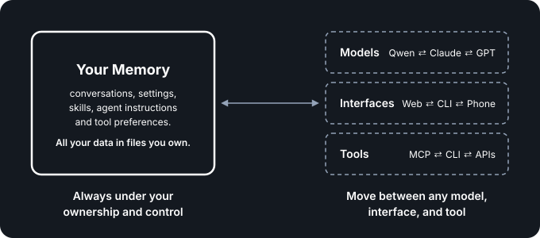

# Architecture Overview

  

We will soon rely on personal AI systems to help us in all areas of our lives.

We should own those systems, so we can always ensure they are working with our best interests in mind, and so the immense wealth created by the AI revolution can flow far and wide, instead of being concentrated in a few Big Tech platforms.

**Own your AI.**

The Personal AI Architecture is a blueprint for building personal AI systems you own and control.

It's not a product you use. It defines the architecture for building personal AI systems that are user-owned and have no lock-in. Systems built on it have:

- No lock-in to a platform (including open source platforms or protocols)
- No lock-in to a vendor
- No lock-in to this architecture

It does this in four ways:

- **Your Memory is separate** from the rest of the system, so you can move it between systems.
- **Everything else is decoupled,** so you can swap any part without affecting the others.
- **The system stays simple:** 4 components and 2 APIs, small enough to run on an average laptop.
- **New abilities come from tools,** not new components.

The Personal AI Architecture is simple enough for an individual to follow, so they can build and maintain their own personal AI system. And it's scalable enough for companies building production-grade personal AI systems for their customers.

Get started building today with our free [TypeScript template](https://github.com/Personal-AI-Architecture/ts-architecture-template), or keep reading for the full overview.

## How it works, in six steps

### 1. Make Your Memory the platform

Your Memory is more than your conversation history. It's also your files, settings, skills, agent instructions and tool preferences. It's what makes a personal AI system personal, so if you want to own your AI, you must own Your Memory.

In traditional software, your data can't be separated from the code that powers it. With AI, it can. So instead of Your Memory living inside a Big Tech platform, Your Memory becomes the platform.

  

Everything else plugs into it, and can be swapped, upgraded or removed. Your Memory stays: in files you can read with standard tools, even when the system isn't running, and that you can take to any other system.

See [memory-spec.md](./memory-spec.md).

### 2. Add the intelligence (the AI model)

Your Memory stays, and intelligence arrives through the Model API, from any provider or your own hardware.

When you want state of the art performance, use the most powerful cloud models. When you want what you send the model to stay on your machine, switch to local models running on your own hardware. Use different models for different tasks.

The architecture makes the fastest-changing part of AI, model capability, the cheapest thing to change.

See [models-spec.md](./models-spec.md).

### 3. Add the hands (the Agent Loop)

Your Memory and the models you use with it are the brain. The Agent Loop is the hands. It sends your request to the model, runs the tools the model asks for, and repeats until the job is done.

  

The Agent Loop is deliberately generic. Everything that makes a product unique (methodology, personality, skills, folder structure) lives in Your Memory, not in the loop. So the Agent Loop isn't part of a platform you're locked into. It's another swappable component.

If a model call fails, the loop may make one recorded retry on the same model and provider the owner selected. It reports a failure that remains; it never quietly chooses a different model or provider (D188).

See [agent-loop-spec.md](./agent-loop-spec.md).

### 4. Add the tools

With intelligence and hands, Your Memory becomes endlessly extensible through tools: read a file, call an API, search a library, control a browser.

New capabilities do not require adding code to a software platform. In fact, they require no software platform at all. They simply require a hand to hold them. Add a tool, and the system can do something new. The architecture doesn't change.

For tools that run as separate services, the owner configures where to find them and the Agent Loop asks those sources what they offer. The Gateway API remains the way clients send requests to the system; it does not register tools (D196).

  

This works because everything the system handles is one of two things. If it's data, it's memory. If it's not data, it's a tool. Even the system's own components reach Your Memory only through tools, so storage can evolve without anything else changing.

See [tools-spec.md](../architecture/tools-spec.md) and [memory-tool-completeness.md](./background/memory-tool-completeness.md).

### 5. Build the open ecosystem

Property rights are the foundation of a free market, and they have been largely missing in the digital world. When individuals own their AI systems, anyone can compete to serve them: infrastructure providers, agent builders, tool creators and more. Value flows to the people who create it, instead of to a few platforms.

That is why this blueprint is open and MIT licensed. See [customization-spec.md](./customization-spec.md) for how implementations build on it.

### 6. Keep Your Memory yours

Two things must stay true for Your Memory to remain under your control:

1. **Your Memory has no outward dependencies.** Everything else depends on it, and it depends on nothing.
2. **Everything else stays decoupled.** Swapping one component has no effect on Your Memory or on any other component.

That lets you use any model, interface or tool without losing control of Your Memory. Five [architecture principles](./principles.md) make sure these two things always stay true.

And it all runs on hardware you control, such as a laptop, desktop or home server. It works fully offline and needs no cloud service. Cloud models, hosting and remote access are choices you can add, not things the system needs. See [deployment-spec.md](./deployment-spec.md).

---

## The parts

Four components, two APIs, and three things outside the system.

  

| Part | Kind | What it does | Spec |
|------|------|--------------|------|
| **Your Memory** | Component | All your data, in files you own. Everything else depends on it; it depends on nothing. | [memory-spec.md](./memory-spec.md) |
| **Agent Loop** | Component | Calls the model, runs the tools it asks for, and repeats until the job is done. | [agent-loop-spec.md](./agent-loop-spec.md) |
| **Gateway** | Component | One front door for every interface. Manages conversations and hands each message to the Agent Loop. | [gateway-spec.md](./gateway-spec.md) |
| **Auth** | Component | Controls who and what gets in. It checks every request and every tool call. | [auth-spec.md](./auth-spec.md) |
| **Gateway API** | API | How interfaces connect. Anything that speaks it plugs in. | [gateway-api.yaml](../contracts/openapi/gateway-api.yaml) |
| **Model API** | API | How the Agent Loop reaches models. Which model and provider to use is your preference. | [model-api.yaml](../contracts/openapi/model-api.yaml) |
| **Clients** | Outside | Any interface: web app, CLI, mobile, bot, voice. | [gateway-spec.md](./gateway-spec.md) |
| **Models** | Outside | The intelligence. The system calls a model; it doesn't contain one. | [models-spec.md](./models-spec.md) |
| **Tools** | Outside | Capabilities in the environment. They describe themselves; the Agent Loop runs them; Auth permits them. | [tools-spec.md](./tools-spec.md) |

**Gateway.** Conversations live in the system, not in any client, so you can start on the web, continue on your phone, and pick up in a terminal. The Gateway stores and loads them through a dedicated internal tool, like any other component that needs Your Memory.

**Auth.** Auth protects Your Memory. It sits on every request, independent of the Gateway and the Agent Loop, so either can be swapped without touching it. Today the actor is usually you, but it is built for more: other people and AI agents acting on your behalf, each with exactly the permissions you grant.

**Adapters.** Three thin translation layers you own sit at the edges: one between clients and the Gateway, one between the Agent Loop and models, and one for each kind of tool source, such as MCP. When an outside standard changes, you swap the adapter, not the system. An unknown or invalid selected adapter is reported at startup; the system does not silently choose another. See [adapter-spec.md](./adapter-spec.md) and [configuration-spec.md](./configuration-spec.md).

A model that is unavailable or lacks a requested ability is reported in a recognizable way across those boundaries. A new tool protocol gets a new adapter and a provenance label without changing the core contract. Optional message and tool metadata travels in designated extension fields; Auth decisions remain separate and strict. See [models-spec.md](./models-spec.md), [tools-spec.md](./tools-spec.md) and [communication-principles.md](./communication-principles.md).

---

## What the architecture must prove

These stories test the architecture itself. Each has a test procedure in [conformance/fs-tests.md](../conformance/fs-tests.md).

| # | Story |
|---|-------|
| FS-1 | **Move Your Memory to a new system.** Export, import on a fresh deployment, preferences honored, nothing lost. |
| FS-2 | **Add a capability without breaking the architecture.** Add a tool, skill, client, or provider. Your Memory gains no dependencies, and the four components stay four. |
| FS-3 | **Run on your own hardware.** Install on a laptop, desktop, or home server. No outside service required. Fully offline. |
| FS-4 | **Swap the model provider.** Config change; the next message uses the new provider and nothing else changes. |
| FS-5 | **Swap the client.** A new client speaks the Gateway API and is served identically. |
| FS-6 | **Evolve Your Memory.** Add semantic search alongside file search; no other component changes. |
| FS-7 | **Swap the Agent Loop.** Replace it; everything else is unaffected. |
| FS-8 | **Expand scope with tools.** Grow from one folder, to your computer, to outside services, by adding tools only. |

---

## Where to go next

| If you want to… | Read |
|---|---|
| Understand the rules behind it | [principles.md](./principles.md) |
| Go deeper on each part | [memory-spec.md](./memory-spec.md), [agent-loop-spec.md](./agent-loop-spec.md), [gateway-spec.md](./gateway-spec.md), [auth-spec.md](./auth-spec.md), [models-spec.md](./models-spec.md), [tools-spec.md](./tools-spec.md) |
| See how it runs and stays safe | [configuration-spec.md](./configuration-spec.md), [deployment-spec.md](./deployment-spec.md), [security-spec.md](./security-spec.md) |
| Build your own system | Start from a [language template](https://github.com/Personal-AI-Architecture), read the relevant component specs and [contracts](../contracts/), then run [conformance checks](../conformance/) |
| Build a product on it | [customization-spec.md](./customization-spec.md) |
| See why decisions were made | [decisions.md](./decisions.md) |

---

## Glossary

| Term | Meaning |
|------|---------|
| **Your Memory** | The platform. Your data, preferences, skills and conversations. No outward dependencies. |
| **Agent Loop** | Sends messages to models, runs tool calls, and repeats until done. |
| **Gateway** | The front door. Manages conversations and routes messages. Any client that speaks the Gateway API works. |
| **Auth** | Controls access. Independent of every other component. |
| **Gateway API** | How clients connect to the system. |
| **Model API** | How the Agent Loop connects to AI models. |
| **Adapter** | A thin translation layer that keeps an API swappable. One side stays stable; the other adapts. |
| **Tools** | Capabilities in the environment. They describe themselves; the Agent Loop runs them; Auth governs them. |
| **Contract** | A defined boundary between components, independent of both sides. |
| **Clients** | Interfaces that connect through the Gateway API: web, CLI, mobile, bot, voice. |
| **Apps** | Combinations of instructions, tools, context, configuration and optional client resources for a specific outcome. An App is not a fifth component. |
| **Architecture** | The product-independent specs, contracts and guidance in this project. |
| **Implementation** | A product or system that follows the Architecture, such as BrainDrive. |
