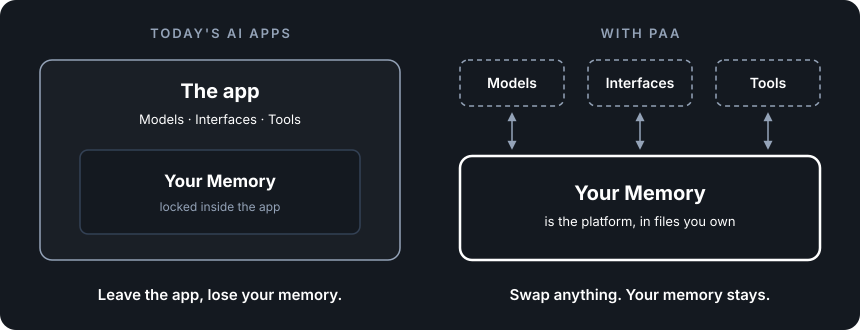

# Architecture Principles

## What the principles are

The principles are the five rules that keep PAA free of lock-in. Every part, contract and decision in the architecture follows from them.

Most systems don't write their rules down. Choices get made one at a time, each sensible on its own, and lock-in builds up quietly: a shortcut here, a dependency there, until leaving would mean starting over.

We think lock-in is rarely one big decision. It's many small ones nobody noticed. So the rules that prevent it need to be written down, short, and easy to check a design against.

So PAA has five principles. Each one protects something specific, and each names the lock-in you take on if you break it. No software enforces them, and you can break any of them and the system still runs. But every break is lock-in you've chosen.

That means anyone building or changing a PAA system can ask one question of any design: which principle does this bend, and what will it cost later?

  

## How it works

The first principle protects the center, and the other four protect everything around it.

| Principle | What it protects | If you break it |
|---|---|---|
| 1. Your Memory depends on nothing | Your Memory outlives every other part | Your Memory is tied to whatever it depends on |
| 2. Keep everything else swappable | Any part can be replaced with a settings change or one swap | Replacing one part means rebuilding others |
| 3. Keep responsibilities where they belong | Swapping one part never requires changing another | Work that leaked has to be untangled before you can swap |
| 4. Keep it simple | One developer with AI coding agents can understand and maintain it all | You depend on a team, or on one person |
| 5. Start constrained, expand deliberately | Every ability is one you chose and can explain | You maintain and secure abilities without knowing why they're there |

The rest of this doc states each principle in full.

---

## 1. Your Memory Should Have No Outbound Dependencies

Your Memory depends on nothing, and everything else depends on it.

Every component reaches Your Memory only through tools, so how it's stored can change without anything else knowing. If a component goes around the tools to the storage directly, or Your Memory starts depending on another component, the two are tied together, and you can no longer swap one without the other.

## 2. Keep Everything Else Swappable

Agent Loop, Auth, Gateway, clients, models, tools, contracts, hosting — all replaceable.

Memory is accessed via tools — change the storage, the tools still work. Components communicate through contracts — swap a component, the contract holds. Contracts are translated through adapters — standard changes, swap the adapter. If changing any of these requires more than a config change or a single-component swap, swappability has been compromised.

Anything that isn't under your ownership and control never connects to your system directly. It always connects through an adapter that is. That covers model providers, client formats and every external tool source, including open protocols like MCP. The adapter can start as a simple pass-through, but it has to be there, so that when the outside format changes or something better arrives, you swap the adapter and nothing else. Boundaries you own on both sides, such as the tools the system uses to reach Your Memory, don't need one.

## 3. Keep Responsibilities Where They Belong

Leaks create lock-in.

The [Responsibility Matrix Verification](../conformance/foundation-verification.md#6-responsibility-matrix-verification) states who owns each responsibility and how to check it. Follow it. If swapping a component requires changes to a different component — not because the contract changed, but because work leaked across the boundary — this principle is broken.

Reality sometimes requires exceptions. When a component must temporarily do work that belongs to another, contain it inside a swappable component so it is removable when no longer needed. Compensating for weaker models is the primary example.

An exception other components depend on isn't an exception — it's architecture you didn't mean to build.

## 4. Keep It Simple

If the system requires a team of developers, you're locked in to that team. That's a dependency as real as any vendor.

The entire system must be understandable and maintainable by one developer + AI coding agents. Four components, two APIs. Before adding a component, an abstraction, or a layer — ask whether it creates an expertise dependency. If only one person understands it, you're locked in to that person.

## 5. Start Constrained, Expand Deliberately

Each expansion — broader scope, more tools, external integrations — is a deliberate step.

Add tools, don't change architecture. Scope is set by which tools exist and what Auth allows (D55), not by changing the architecture. Every capability you grant is a capability you have to maintain, secure, and support. If you can't explain why a capability is active, it shouldn't be.
