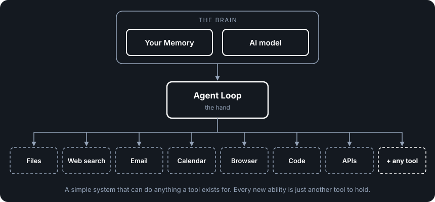

# Tools

**Serves stories:** US-8, US-10, US-17 in the [PAA spec](../spec/personal-ai-architecture-spec.md).

## What tools are

Tools are what let your AI system do things: read a file, search the web, send an email, call an API, control a browser. The model decides which tool to use, and the Agent Loop uses it.

Most AI platforms build a whole system around tools: plugin stores, registries, and integrations the platform has to approve and support. The platform decides which tools you get. If you want something new, you wait for the platform to build or approve it.

We think that's unnecessary. Your hand doesn't need a tool management department between you and your hammer. A tool only needs to say what it does, and something needs to pick it up and use it. The model already knows how to choose tools, and the Agent Loop already knows how to run them.

So in PAA, tools aren't part of the system. They're capabilities in the environment around it: anything that takes an input and returns a result, like an MCP server, a command-line program or a web service. Each tool describes itself, Auth decides who may use it, and the Agent Loop runs it.

This is the big change AI brings. Once a system has a brain (the model and Your Memory) and a hand (the Agent Loop), it can use any tool, the way you can pick up any tool. So a very simple system can do anything a tool exists for, and every new ability is just another tool to hold. Anyone can build a tool, and you can add any tool you like. Add one and your system can do something new. Remove one and it does a little less. Nothing else changes: not Your Memory, not the Agent Loop, not the architecture.

  

## How it works

This works because everything your AI system deals with is one of two things. If it's data, it's memory: your files, a database, your email history. If it's not data, it's a tool: the act of reading, searching or sending. Even the system's own parts reach Your Memory through tools. There's no third kind of thing that needs its own machinery.

- **Finding tools:** the startup settings tell the system where to look. Each tool it finds describes itself: its name, what it does and what it needs.
- **Telling the model:** tool descriptions go to the model with each request. Sending every tool every time would waste space and make the model choose worse. So you pick a small set that's always sent, and the model finds the rest with a search tool when it needs them.
- **Using a tool:** the model asks for one. The Agent Loop checks with Auth that it's allowed, runs it, and sends the result back. Independent calls made together run at the same time.
- **Permissions:** by default you can use every tool, while anyone or anything else starts with none until you grant them. You can also require your approval before certain actions, like sending an email. That's enforced in software, not just requested in a prompt.
- **Tools you don't trust** run isolated, so they can only reach what they're given.
- **Skills aren't tools:** a skill is a recipe written in plain text in Your Memory, and tools are the kitchen equipment. One general-purpose skill tool loads any skill, so adding a skill is just adding a file.

**What it deliberately doesn't have:** no tool registry, no separate tool API and no tool component. Tool calls travel through the Model API like any other reply from the model. How a tool runs, whether as an MCP server, a command or a function, is the Agent Loop's business.

The rest of this doc is the specification: what any implementation of tools must do.

---

## What counts as a tool

Everything the system processes is either data or an operation. Data is memory, wherever it lives. An operation is a tool: read, write, search, query, send, execute. A tool's definition, code and instructions are data; the act of running it is not. The operation has no persistent state. It acts on memory and returns (D135).

A **tool** is a capability in the environment; a **tool call** is one request from the model to use it with specific inputs, and the Agent Loop returns a **tool result**.

What the industry calls "a tool" often mixes the two. This architecture separates them:

| What people call it | Memory (data/noun) | Tool (operation/verb) |
|---|---|---|
| RAG system | Vector store (indexed content) | `semantic_search(query)` |
| Database | Stored records | `sql_query(statement)` |
| Salesforce integration | CRM data (externally hosted) | `salesforce_query(filter)` |
| Knowledge graph | Nodes and edges | `graph_traverse(start, relation)` |
| Search index | Indexed content | `full_text_search(terms)` |
| Email via Gmail | Email history (Google-hosted) | `send_email` tool calling the Gmail API (tool calling tool) |

Pure tools with no memory side exist too: sending a message, running a calculation, controlling a browser. These are operations with side effects.

The full argument for why data and operations cover everything the system handles is in [memory-tool-completeness.md](./background/memory-tool-completeness.md) §1.

### Tools are not a component or an API

Tools are an external dependency (D51). Every tool concern already has a home:

| Concern | Where it lives | Why not a Tools component |
|---------|---------------|--------------------------|
| Tool definitions (name, description, parameters) | **The tools themselves**, through MCP or a manifest | Tools know what they can do. Nobody writes definitions by hand |
| Tool code and executables | **The environment** | Available software isn't a component of this system |
| Instructions for when and how to use tools | **Your Memory** (skills, AGENT.md) | Personal data the model reads |
| Tool preferences (which tools are always sent) | **Your Memory** | "Always load git tools" is about you, not about this machine |
| Tool plumbing (server addresses, ports, secret references) | **Environment config** | Plumbing describes the machine, not the person using it |
| Tool discovery (what's available) | **Configuration** says where to look; tools describe themselves once found | Discovery is knowing where to look |
| Tool execution and results | **Agent Loop** | Already part of the agent loop |
| Tool permissions (who can use what) | **Auth**, and only Auth | Access control is Auth's job |
| Tool installation | **The environment** | Installing a tool changes the deployment environment |

Tools are also not an API (D53). Tool calls are expressed in the Model API, in the model's own tool-call format, and results return the same way in the next message. How a tool is run (MCP server, CLI command, native function) is an Agent Loop implementation detail, not a tool protocol.

### Skills are not tools

A skill is instructions in Your Memory that tell the model what to do, step by step. A tool is a capability in the environment. A skill refers to tools but lives in Your Memory, not in the environment: the model reads it and follows it with the tools available. Skills may include scripts and templates; these also live in Your Memory and run through whatever tools exist.

Every skill is a Markdown file, so skills don't each need a tool. **One generic skill tool loads any skill** into the model's context. Skills and tools change independently: editing or adding a skill needs no tool change, and adding a tool needs no skill change.

## What the system guarantees about tools

| Guarantee | What it means |
|---|---|
| **Adding a tool is adding data** | Adding or removing a tool changes configuration and files only. No code changes to the Agent Loop, Your Memory, the Gateway, Auth or clients. Removing a tool reduces what the system can do and nothing else. |
| **Tools describe themselves** | Nobody writes tool definitions by hand. The Agent Loop runs tool calls without knowing what the tools do. |
| **Permissions live only in Auth** | The Agent Loop asks Auth before every tool call. A refused call does not run. |
| **The owner chooses what the model sees** | The owner, not the tool or the product, decides which tools are always sent and which are found on demand. |
| **Unknown and not permitted are different** | The model can tell "this tool does not exist" apart from "this tool exists but is not permitted". |
| **Untrusted tools are contained** | A tool the owner doesn't trust runs isolated, and a failure of an isolated tool never takes down the Agent Loop. |

## How tools are found

There is no special registration system. The Agent Loop already takes tool definitions as an input alongside the system prompt and conversation history (see [agent-loop-spec.md](./agent-loop-spec.md)). Registration is just how those definitions arrive.

Environment config says where to look (`tool_sources`). The tools then describe themselves:

| Mechanism | How definitions arrive | Example |
|-----------|----------------------|---------|
| **MCP server** | The Agent Loop connects and asks the server what tools it offers | Filesystem tools |
| **Native function** | The definition is part of the tool's own code | The skill tool |
| **CLI tool** | A manifest describes the command and its parameters | Git operations |

The definitions end up in the prompt (if always-send) or the catalog (if discoverable).

For v1, a separate tool service becomes available when the owner installs or configures its source under `tool_sources`. The Agent Loop connects through the tool-source adapter and asks what tools it offers; it can refresh that description when the connected source changes. The adapter binds `source.id` to the configured source, so a service's self-description cannot claim another source's identity. Discovery does not grant permission: Auth still checks each tool call. A service does not register itself through the Gateway API. A product may manage installation or process lifecycle internally, but that does not add a PAA registration route or let an unsolicited service enter the catalog (D196). This leaves the Gateway API for programs that call the system, as described below.

**Tools are identified by source and name.** The canonical identity is `source.id` plus tool `name`, and a tool call carries `source_id`; two tools named `search` from different sources stay distinct without a central naming authority. `source.kind` records provenance only. Endpoints, credentials and adapter settings are runtime configuration, not tool-definition fields.

## What the model sees

Tool definitions are sent through the Model API with the system instructions and conversation. Every definition costs context space on every call, and models choose worse when shown dozens of irrelevant tools. So there are two sets:

The Agent Loop includes selected tool definitions and live tool results in its context check before each model call. A tool result that cannot fit reports `context_overflow`; it is not silently cut to a fixed character count. See GAP-PAA-20 and the [Agent Loop specification](./agent-loop-spec.md). BrainDrive's current 4,000-character tool-result cut is recorded as an implementation gap in the [architecture tests](../conformance/arch-tests.md).

| Set | What it is | How it works |
|---|---|---|
| **Always-send** | Tools the owner uses regularly | Definitions go with every prompt |
| **Discoverable** | Every other tool in the environment | Found on demand through a discovery tool |

**The owner chooses which set each tool is in.** The choice is a preference in Your Memory, so it travels with the owner. An implementation may suggest a starting set, but a tool can't place itself in the always-send set.

**The discovery tool is always sent.** The tool catalog is data: the Agent Loop collects self-descriptions from every tool in the environment into a searchable index that follows tools as they appear and disappear. Discovery has two steps: the model searches and gets a short list of names and descriptions, then loads the full definition it picks. The model decides when to search; the Agent Loop stays a pass-through.

**Not-permitted tools stay visible.** Auth does not hide installed tools. When the Agent Loop prepares tool definitions, it asks Auth which ones the current actor may use and marks the rest `visibility.authorization=not_permitted`, so the model can say "that exists but this account can't use it".

## How a tool call runs

1. **The model produces one or more tool calls** in its reply, through the Model API. It may write text alongside them.
2. **The Agent Loop asks Auth** whether each call is permitted for the current actor.
3. **The Agent Loop runs the permitted calls.** Independent calls requested together run at the same time, not one after another; dependent calls stay in order. Each call uses whatever mechanism its tool needs.
4. **The results go back to the model** as the next message, one result per call. Text the model wrote alongside the calls is kept, not dropped.
5. **The model continues.** It may call more tools or answer.

Tool calls and results are normal parts of messages, in the shared message shape, and are saved in conversation history, so they survive export and are there when the conversation resumes. The Agent Loop doesn't interpret, filter or change tool calls or results. The model decides *what* to call, the Agent Loop handles *how*, and Auth decides *whether*.

## Who can use which tools

What the system can reach (the library folder, the full filesystem, external services) is set entirely by which tools exist and what Auth allows. If a tool doesn't exist, the call can't happen; no separate scope enforcer is needed.

| Layer | What it controls | Who decides |
|-------|-----------------|-------------|
| **Environment**: what tools exist | Which tools are present and executable | The owner, starting from whatever the implementation ships |
| **Auth**: who can use what | Which available tools each actor may use | Permissions in Auth. By default the owner can use every tool. Any other actor starts with no permissions until the owner grants them |
| **Granularity**: how they can be used | Read-only vs read-write, restricted parameters, conditions | Finer-grained Auth permissions |

**The environment decides what exists. Auth decides who can use what. The model is told both.**

**Before each tool call, the Agent Loop asks Auth.** The Agent Loop holds no permissions of its own. If Auth says no, the call doesn't run and the model gets a "not permitted" result, so it can tell the owner what happened. The actor for that check arrives in the canonical transport-neutral `auth_context`; tool execution must not depend on a particular header, message bus or direct-call transport.

**No approval step by default.** The owner can do everything. An owner or product may want approval before some actions, such as writing files or sending email. Those approval rules live in Auth with the other permissions and are enforced at the Agent Loop's check before the call runs. A prompt alone can't enforce them: "always ask before writing" in a system prompt is a suggestion the model might ignore. Whether a product adds approvals, how strict its defaults are and what the prompt looks like are product choices.

When enabled, the check emits the canonical pending `approval-request` with a stable request ID and expiry. An approval-authorized identity resolves it with one terminal `approved`, `denied`, `cancelled` or `expired` decision. Replaying a decision is idempotent and cannot execute the tool twice; conflicting decisions are rejected. The payloads are defined in `contracts/schemas/approval-request.json` and `contracts/schemas/approval-decision.json`.

## Where tools run

| Location | What it means | Example |
|----------|--------------|---------|
| **In-process** | Runs inside the Agent Loop's process. Calls are function calls | A filesystem tool library, native functions |
| **Separate process or container** | Runs alongside the Agent Loop. Calls go over a local channel or the network | A third-party tool suite |
| **Remote service** | Runs on an external server | A hosted code-execution service, a weather API |

**The Agent Loop treats all three the same.** Where a tool runs is a deployment decision. It doesn't change how the Agent Loop works, how the model sees the tool or how Auth governs it. Common mechanisms:

| Mechanism | How it works | When it's used |
|-----------|-------------|----------------|
| **MCP over stdio** | Standard input and output with a local process | Locally spawned MCP servers |
| **MCP over network** | Same protocol over HTTP or WebSocket | Separate or remote MCP servers |
| **CLI execution** | Spawn a process, pass arguments, read output | Git, system utilities |
| **Native function call** | Direct call inside the Agent Loop process | Built-in functions such as the skill tool |

MCP is a common default, but the architecture doesn't require it. Any mechanism that takes input and returns output works. Each mechanism is a tool-source adapter: it turns its tools into canonical definitions, calls and results, so the Agent Loop never sees the protocol (see [adapter-spec.md](./adapter-spec.md) §The three adapters).

### Isolation

A tool the owner doesn't trust runs isolated from the owner's data and from other tools. Every tool has a trust level the owner can see: shipped with the system, installed by the owner, or untrusted. Tools not shipped with the system run isolated by default unless the owner says otherwise. How a product verifies a tool's origin, if it does, is its own choice. Isolation covers four risks:

- **Filesystem access:** the tool sees only what it is given.
- **Network access:** limited to specific hosts, or none.
- **Cross-tool interference:** no shared state or process space.
- **Resource exhaustion:** a runaway tool is throttled or stopped without affecting the Agent Loop.

How isolation is built is up to the implementation (containers, separate processes, sandboxes). Tools from the same trusted source may share a boundary when they are meant to work together. Trusted, well-tested tools may run in-process.

### Lifecycle and health

- **Starting and stopping.** In-process tools start and stop with the Agent Loop. Separate tools can start with it or on first use, and can stop independently. Remote tools are managed independently.
- **Health.** The Agent Loop enforces timeouts on tool calls. A tool that fails, hangs or is unavailable produces a tool result that says so, not a system error; the model decides what to do next. A separate tool crashing doesn't take down the Agent Loop. An in-process crash can, which is why in-process is for trusted, well-tested code.
- **Upgrades.** Separate and remote tools can be upgraded without restarting the Agent Loop: it reconnects and rediscovers their definitions. In-process tools need an Agent Loop restart.

## Programs that call the system

**Any external caller, human client or program, uses the same API to talk to the system.**

| Kind | Relationship to the Agent Loop | Example |
|----------|----------------------|---------|
| **Tools the Agent Loop calls** | Agent Loop → tool. The model chooses and the Agent Loop runs it | Filesystem read and write, Git, skill loader |
| **Agents and programs that call the system** | Program → Gateway API → Agent Loop, the same way a client does | Another AI agent, a scheduled job, a webhook handler |

Software that talks *to* the system goes through the Gateway API. It gets the same Auth checks and the same conversation handling as the owner's own client. No client gets a private path to the Agent Loop that another caller couldn't use.

## How tools grow

- **New abilities are new tools.** Scope grows by adding tools to the environment, with no architectural change.
- **New skills are new files.** The skill tool loads any skill, so the owner can edit or add skills without a developer.
- **Coded tools are the escalation path, not the starting point.** Build a specific coded tool only when prompting hits a ceiling. As models improve, what needs code today may need only a prompt tomorrow.

A working deployment needs very few tools: filesystem operations (read, write, edit, delete, search, list) for Your Memory, a skill tool, and a version history tool (Git is one option). This set is illustrative; an implementation decides which tools ship.

## Checking an implementation

- [ ] Adding or removing a tool means adding or removing data (configuration, files). No code changes to the Agent Loop, Your Memory, the Gateway, Auth or clients
- [ ] Tools are not treated as a component or a separate API
- [ ] Each tool describes itself, and the Agent Loop discovers it through the configured tool sources
- [ ] A separate service's tools enter the catalog through an owner-configured source and self-description, without a Gateway API registration route or unsolicited self-registration (D196)
- [ ] The Agent Loop runs tool calls without knowing what the tools do
- [ ] The Agent Loop asks Auth before every tool call. Permissions live only in Auth
- [ ] By default the owner can use every tool, with no approval step. Any other actor starts with no permissions until the owner grants them
- [ ] If the owner sets approval rules, they are enforced in software before the call runs, not by prompt
- [ ] The model can tell "this tool does not exist" apart from "this tool exists but is not permitted"
- [ ] When the model asks for several independent tool calls at once, they run at the same time, and text the model wrote alongside them is kept
- [ ] Tool calls and tool results are parts of messages and are saved in conversation history
- [ ] The owner, not the tool or the product, chooses which tools are always sent and which are discoverable, without code changes
- [ ] A discovery tool can find and load tools from the discoverable set at runtime
- [ ] Skills and tools change independently
- [ ] *(security)* A tool the owner doesn't trust runs isolated from the owner's data and other tools, with restricted filesystem access, restricted network access and resource limits
- [ ] *(security)* Isolation does not depend on Auth: even if Auth fails, an isolated tool can't escape its boundary
- [ ] *(security)* Every tool has a trust level the owner can see: shipped with the system, installed by the owner, or untrusted
- [ ] *(security)* A failure of an isolated tool does not take down the Agent Loop. Tool failures reach the model as tool results

The security requirements come from [security-spec.md](./security-spec.md), which owns the why.

## Decisions

| # | Decision | Rationale |
|---|----------|-----------|
| D51 | Tools are not a component. They are capabilities in the environment, executed by the Agent Loop and governed by Auth | Every tool concern maps to an existing part: tools describe themselves, the Agent Loop executes, Auth decides access, preferences live in Your Memory, plumbing lives in environment config. No gap needs a dedicated component |
| D53 | No separate tool API. Tool calls flow through the Model API, and tool execution is an Agent Loop implementation detail | The Model API already expresses tool calls and returns results. The architecture has two APIs, not three |
| D135 | Memory/tool binary: if it's data, it's memory; if it's not data, it's a tool | Everything the system processes is a noun or a verb. No third category |

The configuration split behind this spec (definitions from the tools, plumbing in environment config, preferences in Your Memory) is set out in [configuration-spec.md](./configuration-spec.md).

## Contract alignment

The canonical contract tree under `contracts/` is authoritative for tool-definition
and message shapes. Tool definitions use `parameters` for their JSON Schema input,
`source.id` plus `name` as stable identity, and separate owner-selected visibility
mode from Auth's permitted/not-permitted marker. Adapter endpoints and credentials
are not definition fields. The shared message contract carries `source_id` on tool
calls, and the Model API stream uses explicit event discriminators. The generic
tool-definition contract includes a canonical `memory_restore` example with an opaque
`version` identifier. Approval lifecycle, parallel execution, and “exists but not
permitted” behavior remain architectural requirements that implementations must enforce.
When a running actor is revoked, the Gateway cancellation operation prevents new
tool calls and the Agent Loop emits the canonical authorization error.
